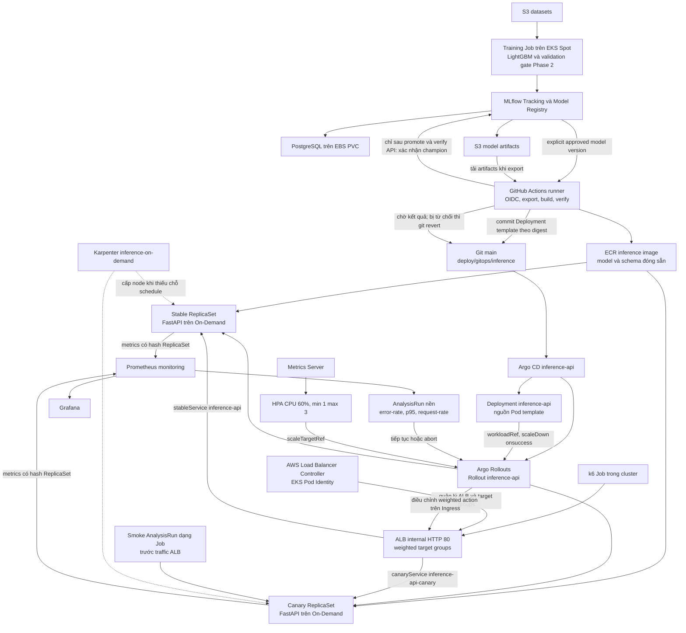

# Phase 4 — Implementation Review & Project Handoff Report

> **Repository:** `HaiXon231/mlops-platform-aws`
>
> **Ngày khảo sát:** 15/11/2026, múi giờ Asia/Ho_Chi_Minh; các mốc chạy hệ thống trong báo cáo dùng UTC nếu không ghi khác.
>
> **Mốc code được audit:** `db04cc2122e7eaacd041e0cbcf7a675094842330` (`main`).
>
> **Mốc evidence Phase 4:** 05/11/2026; đây là lịch sử được lưu trong repository, không phải kết quả kiểm tra live ngày 15/11.
>
> **Phạm vi thực thi:** đọc tài liệu, code, Git và artifacts; chạy kiểm thử local/offline và thử truy vấn read-only. Chỉ tạo báo cáo này, không triển khai, thay đổi Registry, dispatch workflow, apply/destroy hay commit/push.

## I. Executive Summary — Tóm tắt điều hành

### 1. Mục tiêu và phạm vi

Theo `MLOps_AWS_Implementation_Plan_v1.0.1.md`, mục 3.4, Phase 4/M4 và tiêu chí Tầng 2 tại mục 7, Phase 4 cần bổ sung **progressive delivery** lên nền tảng Phase 1–3: phân phối 90% traffic cho stable và 10% cho canary, tăng tới 100% khi đạt metric vận hành, tự abort/rollback khi không đạt, và khôi phục đúng desired version trong GitOps. Các thành phần được kế hoạch lựa chọn là AWS Load Balancer Controller, ALB, Argo Rollouts và Prometheus AnalysisTemplate. Phase này không thay thế model validation gate của Phase 2 và không bao gồm drift/retraining của Phase 5.

**Giới hạn nguồn proposal:** tìm thấy Implementation Plan v1.0.1 trong repository và bản cùng tên tại thư mục cha; hai bản chỉ khác khoảng trắng cuối hai dòng mở đầu. Plan dẫn lại proposal PDF, nhưng không tìm thấy PDF proposal MLOps gốc trong repository hoặc các PDF ở cây thư mục môn học đã dò. Vì vậy, đối chiếu requirement trong báo cáo dựa trên bản Plan có trong Git; chưa đối chiếu độc lập với PDF gốc.

### 2. Kết luận chính

**Phase 4 đã hiện thực các cơ chế chính và có evidence dev lịch sử cho cả canary thành công lẫn canary bị từ chối rồi tự hoàn nguyên Git.** Không có cơ sở để gọi đây là triển khai production hoặc xác nhận hệ thống đang hoạt động tại thời điểm bàn giao.

| Khía cạnh | Kết luận có bằng chứng |
| --- | --- |
| Implementation | Có Rollout nhận Pod template qua `workloadRef`, hai Service stable/canary, ALB internal, smoke analysis, bốn metric gates, HPA trỏ Rollout, dashboard và scripts quan sát. Xem mục III. |
| Traffic thực trong lịch sử | Evidence ghi canary nhận 8,71–9,36% ở bước 10% và 50,67–51,40% ở bước 50%; không chỉ chia theo số Pod. Nguồn: `docs/evidence/phase-04.md`, mục 4. |
| Promote | T2 tự đi tới `Healthy`; workflow thật `42011637577` thành công, tạo commit `e235328`. Model vẫn là v1, alias trả `already-promoted`. |
| Rollback | T3 latency làm Rollouts tự abort. Sau đó workflow `42016449106` bị gate error-rate từ chối bằng tải 422, tự tạo revert `ffff3ad` cho release `fc88cfa`. Git xác nhận nội dung manifest được khôi phục. |
| Kiểm thử tại phiên audit | 33 tests riêng Phase 4 pass; 75 tests khi loại riêng file `test_inference.py` pass. Full suite chưa hoàn tất vì treo khi vào `TestClient`; không được ghi là full-suite pass. |
| Live AWS/EKS/GitHub | Chưa xác minh: AWS không kết nối được endpoint đăng nhập để lấy credentials; kubectl thất bại cùng nguyên nhân; GitHub API không kết nối được. |
| Khoảng trống nghiệm thu | Chưa có demo cloud chuyển giữa hai Registry model versions khác nhau; smoke-fail và lỗi 5xx/model lỗi thật chưa có evidence; raw logs/snapshots Phase 4 không có trong checkout. |

Điểm nổi bật là giữ đường phát hành image theo digest và bổ sung rollback ở hai lớp: **Rollouts khôi phục traffic**, còn **runner khôi phục Git**. Giới hạn đáng chú ý: rollback Git chỉ tự động trong release workflow còn chạy và nhận đúng trạng thái bị từ chối; không áp dụng cho mọi lỗi hoặc mọi thay đổi Git thủ công.

### 3. Nguồn và cách đánh giá bằng chứng

| Nhóm nguồn | Đã đối chiếu | Giá trị và giới hạn |
| --- | --- | --- |
| Requirements | Plan v1.0.1; `docs/phases/phase-04-design.md` | Plan là chuẩn đối chiếu; design chứa cả quyết định và checkpoint cũ. |
| Tài liệu dự án | `README.md`, `Makefile`, `docs/setup.md`, `docs/operations.md`, `docs/architecture.md`, tài liệu/evidence Phase 1–5 | Dùng giải thích vận hành và lịch sử; đối chiếu lại với code. |
| Code và cấu hình | `src/`, `configs/`, `infra/terraform/`, `deploy/`, `.github/workflows/`, `scripts/`, `tests/` | Xác nhận tính năng tồn tại, tham số và ranh giới tự động hóa. Diff Phase 4 không thay đổi `src/` hoặc workflow YAML. |
| Git | Status, branches/refs, log, diff từ `a4c8191`, release/revert commits | Bằng chứng trực tiếp cho thay đổi code và desired manifest; không chứng minh trạng thái cluster. |
| Evidence dev | `docs/evidence/phase-04.md`, mục 1–13; evidence Phase 1–3 | Các phép đo lịch sử được người triển khai ghi lại; không có raw logs Phase 4 để tái tính độc lập. |
| Local ngoài Git | `docs/_local/`, bundle ở `artifacts/releases/`, training artifacts, `backups/cloud-last-key.txt`, tên/mốc thời gian saved plans | Cung cấp bối cảnh; các checkpoint này cũ hơn Phase 4, không đại diện live state. Không đọc/công bố secrets hoặc toàn bộ Terraform state. |
| Kiểm tra mới | Test output, Kustomize/validator/format, lỗi truy cập AWS/kubectl/GitHub | Kết quả trực tiếp ngày 15/11; ghi tại mục V. |

Các trạng thái `Completed` ở mục VIII nghĩa là implementation và evidence lịch sử đủ cho phạm vi của dòng đó. Chúng **không** có nghĩa đã chạy lại AWS end-to-end trong phiên audit.

## II. Architecture — Kiến trúc thực tế

### 1. Sơ đồ thành phần và các luồng



Đây là kiến trúc được code khai báo và evidence lịch sử xác nhận, không phải sơ đồ tài nguyên live ngày audit. Phân phối 90/10 chỉ áp dụng khi request đi **qua ALB**. Gọi trực tiếp hoặc port-forward `service/inference-api` đi vào stable Service, không kiểm tra được ALB splitting. Smoke gọi riêng canary Service trước khi canary nhận traffic ALB.

### 2. Công nghệ và cấu hình nền

| Thành phần | Version/cấu hình trong repository hoặc evidence | Nguồn |
| --- | --- | --- |
| EKS/VPC | Kubernetes khai báo `1.36`; VPC `10.20.0.0/16`, hai AZ, private workers, một NAT, S3 Gateway Endpoint | `infra/terraform/platform/eks.tf`, `network.tf` |
| Terraform | `1.16.6`; platform AWS provider `6.69.1`; EKS module `21.26.0`, VPC module `6.7.3` | `versions.tf`, `eks.tf`, `network.tf` |
| AWS Load Balancer Controller | Chart pin `3.6.2`; evidence ghi controller `v3.6.2`; một replica trên system nodes | `scripts/k8s-common.sh`, Helm values, evidence mục 1 |
| Argo Rollouts | Chart `2.43.9`; evidence ghi controller `v1.10.2`; một replica, dashboard tắt | `scripts/k8s-common.sh`, `deploy/platform/argo-rollouts-values.yaml` |
| Argo CD/Karpenter | Chart Argo CD `10.10.5`; Karpenter `1.14.1` | `scripts/k8s-common.sh` |
| ML/serving | Python 3.12, MLflow `3.6.0`, FastAPI `0.156.8`, Pydantic `2.14.1`, Uvicorn `0.54.0`, LightGBM theo lockfile | `pyproject.toml`, `uv.lock`, `deploy/inference/Dockerfile` |
| Monitoring | Prometheus chart `29.37.1`, Grafana chart `14.0.1`; scrape inference 15 giây, retention 24 giờ, storage ephemeral | `scripts/m33.sh`, `deploy/monitoring/*values.yaml` |
| Load test | Image `grafana/k6:1.8.2`; chạy trong cluster, fixed arrival rate qua biến `LOAD_*` | `deploy/monitoring/k6-job.yaml.tpl`, `k6.js` |
| Scheduling | Training Spot; serving On-Demand; system group `t3.large`, min/desired/max 2 | `deploy/bootstrap/karpenter-nodepools.yaml`, `infra/terraform/platform/eks.tf` |

Các version trên mô tả cấu hình đã pin, không phải khuyến nghị nâng cấp hoặc khẳng định version đang chạy hiện tại.

### 3. Phân chia quyền sở hữu

- **Terraform:** VPC/EKS, system node group, IAM/Pod Identity, EKS add-ons và backend state. Phase 4 thêm IAM cho LB Controller; không khai báo ALB bằng Terraform.
- **Helm/scripts add-on:** cài LB Controller và Rollouts; monitoring vẫn được Helm quản lý riêng, không được thêm vào Argo CD Application inference.
- **Argo CD:** đồng bộ Deployment template, Rollout, hai Services, Ingress, hai AnalysisTemplates và HPA qua Kustomize.
- **Argo Rollouts:** tạo ReplicaSets/AnalysisRuns và smoke Jobs; quản lý hash selectors của Services và annotation weighted action trên Ingress.
- **AWS Load Balancer Controller:** hiện thực Ingress thành ALB/target groups/TargetGroupBindings và các tài nguyên mạng liên quan.
- **HPA:** quản lý `Rollout.spec.replicas`; Application automated bỏ qua `/spec/replicas` của cả Deployment và Rollout, dùng `RespectIgnoreDifferences=true`.
- **GitHub runner:** build/push, commit release, nhận biết kết quả, revert khi bị từ chối và xác nhận champion sau verification. RBAC bổ sung chỉ cho phép đọc Rollout/AnalysisRuns, không patch/abort/promote Rollout.

Nguồn: các manifests trong `deploy/gitops/inference/`, `deploy/argocd/`, `deploy/bootstrap/m32-github-release-rbac.yaml`, `scripts/m41.sh`, `scripts/m32_release.sh`.

## III. Implementation Details — Chi tiết hiện thực

### 1. IAM, capacity và cài add-on

`infra/terraform/platform/alb_controller.tf` thêm bốn managed resources: IAM policy, role, policy attachment và EKS Pod Identity association. Trust principal là `pods.eks.amazonaws.com`; conditions ràng buộc cluster, namespace `kube-system` và service account `aws-load-balancer-controller`. Policy JSON được vendored tại `infra/terraform/platform/policies/aws-load-balancer-controller-v3.6.2.json`; output mới là `alb_controller_role_arn`. Audit xác nhận file/pin tồn tại, chưa tải lại bản upstream để kiểm tra tính trùng khớp.

System managed node group tăng min/desired từ 1 lên 2, max giữ 2. Lý do ghi trong design/evidence là CPU requests của node cũ đã khoảng 91%, không đủ chỗ cho hai controllers bổ sung. Với node group đã tồn tại, EKS module bỏ qua thay đổi `desired_size`; evidence ghi phải tăng desired qua AWS CLI trước khi áp dụng `min_size=2`.

`scripts/m41.sh` có ba chế độ:

| Chế độ | Hành vi |
| --- | --- |
| `deploy` | Kiểm tra đúng cluster, đọc Terraform outputs IAM/VPC, cài hai Helm releases theo version pin; truyền clusterName/region/vpcId rõ ràng cho LB Controller. |
| `verify` | Chờ hai controller Deployments; xác nhận ba CRD `rollouts`, `analysistemplates`, `analysisruns` Established; kiểm tra IngressClass `alb`, biến Pod Identity được inject và log gần nhất không chứa lỗi quyền AWS. |
| `cleanup` | Từ chối nếu còn ALB Ingress hoặc Rollout; chỉ uninstall controllers sau đó, giữ CRDs theo hành vi Helm được script mô tả. |

LB Controller và Rollouts mỗi controller một replica; không có HA controller được cấu hình trong values. LB Controller tắt tích hợp Shield/WAF/WAFv2. Những lựa chọn này phù hợp môi trường dev nhỏ, chưa phải cấu hình production.

### 2. Adoption Deployment sang Rollout

`deploy/gitops/inference/rollout.yaml` không chứa Pod template riêng. `workloadRef` trỏ `apps/v1 Deployment/inference-api`, `scaleDown: onsuccess`. Vì vậy release vẫn chỉ sửa `deploy/gitops/inference/deployment.yaml`; không cần thay format của `m32_gitops.py` hoặc validator Phase 3.

Sau adoption thành công, Deployment có thể ở **0/0** trong khi các Pods phục vụ do Rollout sở hữu. Evidence mục 2 ghi đúng trạng thái này; không được kết luận serving down chỉ từ Deployment replicas. Trường `status.workloadObservedGeneration` được dùng để đảm bảo controller đã quan sát đúng generation của template mới.

HPA tại `hpa.yaml` chuyển `scaleTargetRef` sang `argoproj.io/v1alpha1 Rollout/inference-api`; giữ CPU target 60%, min 1, max 3, scale-down stabilization 300 giây. Canary có `setCanaryScale.replicas: 1`, không có bước đặt lại `matchTrafficWeight`; cấu hình này không tăng canary replicas theo weight 10%/50%. Cũng không nên hiểu `maxReplicas=3` là giới hạn cứng cho tổng stable cộng canary Pods trong quá trình rollout.

Application automated vẫn `selfHeal=true`, `prune=false`, theo nhánh `main`. Application manual không được bổ sung ignore-differences tương tự; file này là bootstrap/adoption path cũ, không nên coi tương đương cấu hình automated hiện hành.

### 3. ALB và traffic splitting

`ingress.yaml` khai báo ALB **internal**, `target-type: ip`, listener HTTP 80, inbound CIDR VPC `10.20.0.0/16`, health check `/readyz` mỗi 15 giây. Backend dùng `inference-api` với port name `use-annotation`; repository chủ ý không hardcode annotation `actions.inference-api`, vì Rollouts quản lý weighted action.

Hai Services `inference-api` và `inference-api-canary` đều ClusterIP port 8000. Selector trong Git chỉ có `app=inference-api`; Rollouts bổ sung hash tương ứng khi vận hành. Cách này chia theo **ALB target group weights**, không dùng tỉ lệ replicas để xấp xỉ 90/10. Evidence mục 2 ghi hai TargetGroupBindings được tạo và weighted action stable 100/canary 0 sau adoption.

ALB internal yêu cầu nguồn kiểm thử có đường mạng vào VPC. Công cụ hiện tại dùng k6 Job trong cluster; không có public inference endpoint, TLS listener hoặc authentication cho API được bổ sung trong Phase 4.

### 4. Các bước canary và smoke

| Bước theo manifest | Hoạt động | Điều kiện/ý nghĩa |
| --- | --- | --- |
| 0–1 | Tạo một canary Pod, weight 0 | Canary chưa nhận traffic ALB. |
| 2 | Inline analysis `inference-canary-smoke` | Job gọi trực tiếp canary Service. |
| 3–4 | Weight 10, pause 2 phút | Background analysis bắt đầu từ `startingStep: 3`. |
| 5–6 | Weight 50, pause 2 phút | Tiếp tục bốn metric gates. |
| Kết thúc steps | Rollouts tự promote, traffic 100% vào phiên bản mới | Không có `setWeight:100` tường minh trong YAML; đây là hành vi kết thúc canary steps, đã được evidence ghi nhận. |

Smoke template nằm cùng file `analysis-template.yaml` với metric template. Job dùng `curlimages/curl:8.11.1`, chạy trên system node, `backoffLimit=1`, `activeDeadlineSeconds=180`, kiểm tra:

1. `/readyz` có chuỗi `"ready"`.
2. `/model-info` có `"approval_status":"approved"`.
3. `/predict` với request hợp lệ có khóa `predicted_duration_minutes`.

**Khác với ý định trong design:** smoke hiện không so sánh exact model version, digest, release ID hoặc checksum, cũng không kiểm tra số dự đoán bằng một JSON assertion đầy đủ. Kiểm tra danh tính chi tiết và giá trị dự đoán hữu hạn được runner làm **sau khi promote**. Không mô tả smoke trước traffic là đã xác nhận đầy đủ provenance của candidate.

### 5. Prometheus analysis và xử lý thiếu mẫu

Prometheus giữ label `rollouts_pod_template_hash` bằng relabel từ Kubernetes Pod discovery. `Rollout` truyền hai args `Latest` và `Stable` cho AnalysisTemplate. Analysis chỉ dùng `/predict`; không dùng MAE/RMSE, drift hoặc ground-truth labels.

| Metric | Truy vấn/cửa sổ chính | Thành công | `failureLimit` / `inconclusiveLimit` |
| --- | --- | --- | --- |
| `error-rate` | Tổng rate `inference_http_errors_total` / tổng rate requests của canary, `[1m]` | `< 0,01` | 1 / 3 |
| `p95-latency-seconds` | `histogram_quantile(0.95, sum by (le)(rate(...bucket[2m])))` của canary | `< 0,5 giây` | 1 / 3 |
| `p95-latency-vs-stable` | p95 canary trừ `(1,5 × p95 stable + 0,05 giây)`, `[2m]` | `< 0` | 1 / 3 |
| `canary-request-rate` | Tổng request rate của canary, `[1m]` | `>= 0,2 req/s` | 3 / 3 |

Các metric chạy mỗi **30 giây**, không đặt `count`, nên là analysis nền trong thời gian rollout. Evidence T3 và workflow lỗi ghi failure xảy ra sau hai phép đo fail đối với metric có `failureLimit=1`; không nên diễn giải là một phép đo vượt ngưỡng lập tức rollback.

Counter lỗi của ứng dụng chỉ có series sau lỗi đầu tiên. Commit `f4862fe` thêm `or vector(0)` cho **tử số**, tránh một canary không có lỗi bị đánh `NaN`. Mẫu số không được đổi thành 0 giả; truy vấn có fallback `vector(0)/vector(0)` để dữ liệu trống không trở thành pass. Tuy nhiên cần phân biệt:

- Không có series/mẫu: có thể nhận `NaN` → inconclusive.
- Có counter nhưng rate thấp/0: metric request-rate có thể **fail**, theo `failureLimit=3`.
- `Inconclusive` có thể làm rollout pause chờ xử lý; không đồng nghĩa luôn tự abort và revert.

`src/inference/metrics.py` đếm mọi HTTP status `>=400` vào errors, gồm 4xx. Latency là middleware ứng dụng đo request đã tới Pod, không phải end-to-end ALB latency. Timeout trước khi tới ứng dụng có thể không phản ánh trong error-rate gate.

### 6. Release, promotion và automated rollback

Workflow vẫn tên **M3.2 approved model release** tại `.github/workflows/m32-release.yml`; Phase 4 sửa scripts được workflow gọi, không tạo workflow mới. Luồng đầy đủ:

1. Dispatch trên `main`, nhận model name và **numeric version rõ ràng**; kiểm tra repo identity, chạy `make m32-test`.
2. GitHub OIDC assume role; tạm thêm runner IPv4 `/32` vào EKS API CIDRs bằng `m32_eks_cidr.py`. Snapshot baseline được lưu trên runner trước cập nhật.
3. Runner port-forward cloud MLflow ở `127.0.0.1:15000`; `inference.export` chỉ export model READY/approved, đối chiếu Registry/run tags, schema, manifest hash và prediction parity.
4. Chuẩn bị bundle với release ID/source SHA, build image, validate bundle trong container `--network none`, push ECR rồi lấy digest thật.
5. `m32_gitops.py render` sửa một Deployment template; runner tạo **một commit release**, push non-force lên `main`.
6. `m32_verify.py --wait-outcome` chờ rollout promoted hoặc aborted, tối đa 1.800 giây, poll 10 giây.
7. Nếu promoted: chờ Application đúng commit `Synced/Healthy`, stable/current hash trùng, stable Pods Ready với đúng image/imageID; mở inference tunnel, kiểm tra API metadata, prediction và Registry rồi set/confirm `champion` idempotently.
8. Nếu bị từ chối: CLI trả exit code **3**; script fetch `origin/main`, chỉ revert nếu main vẫn đúng release commit; tạo/push một `git revert`, chờ `--wait-reverted` tối đa 900 giây, rồi kết thúc workflow **failure**. Nhánh này không gọi promotion.
9. Bước workflow `if: always()` cố khôi phục chính xác EKS CIDRs ban đầu, cả khi release step thất bại.

`rollout_state()` nhận biết bị từ chối khi template/generation đúng release, current hash khác stable, và có `abort=true` **hoặc** `phase=Degraded`. Nhánh thứ hai cần cho `ProgressDeadlineExceeded`, vốn từng không có cờ abort trên cluster.

**Ranh giới tự động hóa cần giữ khi bàn giao:**

- Rollouts abort không tự sửa Git. Direct commits trên nhánh thử đã cần revert bằng tay; workflow chính thức mới sở hữu automatic Git revert.
- Timeout, API/Registry verification lỗi sau promote, lỗi mạng hoặc `main` di chuyển không đi vào nhánh exit 3; script fail nhưng không tự revert cho mọi trường hợp này.
- Nếu branch protection/concurrent commits chặn revert, script dừng và báo lỗi; không force push. Git có thể còn digest bị từ chối dù traffic đã về stable.
- `wait_for_reverted()` xác nhận Application tại revert commit và `Healthy/current=stable`; hàm không tự so lại exact previous digest qua API hoặc đọc lại champion trong nhánh rollback. Git diff và read-only Registry/API checks bổ sung vẫn cần cho nghiệm thu độc lập.
- `champion` là alias Registry, không điều khiển weighted routing. Trong canary, alias cũ giữ nguyên; nó chỉ được cập nhật sau khi release mới phục vụ ổn định và qua verification.

### 7. Quan sát, dashboard và load tools

`scripts/m42.sh status` đọc Rollout, AnalysisRuns gần nhất, Ingress và Pods có hash. Chế độ `split` port-forward Prometheus, truy vấn `increase(inference_http_requests_total{path="/predict"}[window])` theo hash, rồi `scripts/m42_split.py` tính tỷ lệ stable/canary/other. Không có request hoặc Prometheus trả lỗi thì công cụ báo lỗi, không in tỉ lệ 0% như một kết quả hợp lệ. `increase()` có thể trả số thập phân do extrapolation; số request như 907,5 trong evidence không phải raw count nguyên từ access log.

Dashboard `deploy/monitoring/inference-dashboard.json` có bảy panels: giữ bốn panels Phase 3 và thêm ba panels theo hash cho request rate, error rate, p95. Chưa có metric/panel riêng cho ALB weight hoặc đánh dấu promotion như ý định trong design; xem weight qua Rollout/Ingress.

`scripts/m33.sh` thêm `M33_TARGET=alb`, đọc và validate hostname ALB trước khi tạo load Job. `M33_PAYLOAD=invalid` là opt-in, chỉ được dùng với target ALB; gửi location 999 để ứng dụng trả 422. k6 coi 422 là expected trong chế độ đó, trong khi metric ứng dụng vẫn đếm error. Tải này đi tới cả stable và canary theo ALB, không phải fault được cô lập chỉ ở candidate.

Giới hạn công cụ: 1–50 VUs, 1–200 req/s, 30–900 giây; k6 Job TTL 3.600 giây. `LOAD_VUS/RATE/DURATION/BASE_URL/PAYLOAD` thay cho biến gốc `K6_*` để `constant-arrival-rate` hoạt động. Workflow release không tự tạo traffic generator; người vận hành đã bật k6 riêng trong các lần kiểm chứng.

## IV. Repository Changes — Thay đổi repository

### 1. Baseline và thống kê

Chọn `a4c8191` ngày 23/10/2026 làm baseline ngay trước chuỗi implementation Phase 4; commit Phase 3 monitoring quan trọng trước đó là `686b30d`. Lệnh `git diff --stat a4c8191..HEAD` tại mốc audit trả **40 files changed, 2.162 insertions, 83 deletions**; `--name-status` có **17 file thêm, 23 file sửa, không file xóa**. Đây là net diff giữa hai revisions, không bao gồm báo cáo mới hoặc `.idea/` ngoài Git.

### 2. Danh sách đầy đủ theo net diff

| Nhóm | File thêm mới | File sửa |
| --- | --- | --- |
| GitOps serving | `deploy/gitops/inference/analysis-template.yaml`, `ingress.yaml`, `rollout.yaml`, `service-canary.yaml` | `deploy/gitops/inference/deployment.yaml`, `hpa.yaml`, `kustomization.yaml` |
| Argo CD/RBAC | Không | `deploy/argocd/inference-application-automated.yaml`; `deploy/bootstrap/m32-github-release-rbac.yaml` |
| Add-on values | `deploy/platform/argo-rollouts-values.yaml`; `deploy/platform/aws-load-balancer-controller-values.yaml` | Không |
| Monitoring | Không | `deploy/monitoring/inference-dashboard.json`, `k6-job.yaml.tpl`, `k6.js`, `prometheus-values.yaml` |
| Terraform | `infra/terraform/platform/alb_controller.tf`; `infra/terraform/platform/policies/aws-load-balancer-controller-v3.6.2.json` | `infra/terraform/platform/eks.tf`, `outputs.tf` |
| Scripts | `scripts/m41.sh`, `m42.sh`, `m42_split.py` | `scripts/k8s-common.sh`, `m32_release.sh`, `m32_verify.py`, `m33.sh` |
| Tests | `tests/unit/test_m4_manifests.py`, `test_m41_addons.py`, `test_m42_canary_tools.py`, `test_m46_release_canary.py` | `tests/unit/test_m33_config.py` |
| Tài liệu/entry points | `docs/phases/phase-04-design.md`; `docs/evidence/phase-04.md` | `Makefile`, `README.md`, `docs/architecture.md`, `docs/evidence/README.md`, `docs/operations.md`, `docs/phases/phase-04.md`, `docs/setup.md` |

Trong các ô liệt kê rút gọn, filenames dùng cùng thư mục với path đầy đủ đứng trước. `service.yaml`, Application manual, `src/`, Dockerfile inference, Terraform bootstrap/persistent, release IAM của Phase 3 và cả hai workflow YAML **không có net diff Phase 4**. Thay đổi CI/CD nằm ở scripts và tests được workflows có sẵn gọi. Không có workflow train tự động mới hoặc image exporter/control Job/PostSync mới.

So với Phase 3, thay đổi cốt lõi là serving runtime từ Deployment RollingUpdate sang Rollout; thêm ALB weighted path và gates; HPA đổi scale target; runner hiểu multi-ReplicaSet và có nhánh revert; monitoring phân biệt ReplicaSet. Training/feature contract/model validation không thay đổi.

### 3. Các commits quan trọng

Các commits dưới đây tồn tại trong object database và reachable từ `main` tại checkout audit. Các commits implementation/tài liệu đều ngày 05/11/2026; author time của release bot dùng UTC, các commits của người phát triển phần lớn dùng `+07:00`.

| Commit | Mục đích/giá trị bàn giao |
| --- | --- |
| `55294e3` | Canary manifests, ALB IAM/Pod Identity, system capacity, Helm installer, tests nền. |
| `ad9e8a2` | Observation tools, dashboard/k6 ALB, canary-aware release/verify và RBAC. |
| `7fe2288` | Sửa xung đột biến k6 và `trap EXIT` của canary-split. |
| `f4862fe` | Sửa error counter rỗng thành 0 khi chưa có lỗi, giữ thiếu request là unknown. |
| `d61a1de` | Test trường hợp `Degraded` không có `abort`. |
| `6dc8163` | Evidence/status sau canary dev, cập nhật roadmap/docs. |
| `a069afa` | Merge PR #1, nhánh `m4/canary-rollout` vào main. |
| `e235328` | Bot commit release `m32-42011637577-1`, image digest được chấp nhận. |
| `694a169` | Ghi release thật và thêm invalid-payload load mode. |
| `fc88cfa` | Bot commit release `m32-42016449106-1`, sau đó bị từ chối. |
| `ffff3ad` | Bot revert `fc88cfa`; nội dung commit ghi rõ commit bị revert. |
| `5c56c23` | Ghi evidence nhánh abort/automatic revert thật. |
| `184af1c` | Merge PR #2, release evidence. |
| `0bda4d6` | Lấp khoảng trống runbook về quyền, CIDR, load và cleanup sau audit lịch sử. |
| `db04cc2` | Merge PR #3, HEAD hiện tại của checkout. |

Evidence còn dẫn revert `1a179cf`, `2439820`, `119329d` trên nhánh thử `m4/canary-tests`. `git cat-file -e '<sha>^{commit}'` đều không tìm thấy chúng trong checkout hiện tại. Chỉ có thể ghi nhận các lần revert thủ công đó theo tài liệu, không xác minh nội dung commit độc lập. `git branch -avv` chỉ thấy local `main` và cached `origin/main`/`origin/HEAD`; không có nhánh thử còn được lưu ở refs local.

## V. Deployment & Verification — Triển khai và kiểm chứng

### 1. Trình tự đã thực hiện theo evidence lịch sử

Trình tự dưới đây được tổng hợp từ evidence ngày 05/11, commits và runbook đã bổ sung; audit này không thực hiện lại:

1. Chuẩn bị IAM/Pod Identity và nâng system node group. Lần apply đầu bị lỗi min capacity lớn hơn desired; sau khi nâng desired bằng CLI mới tiếp tục được.
2. Cài LB Controller và Argo Rollouts; verify controllers, CRDs, IngressClass và Pod Identity.
3. Cho Argo CD theo nhánh thử, nhận Deployment qua workloadRef; xác nhận Deployment 0/0, Rollout Healthy, HPA trỏ Rollout và ALB có hai target groups.
4. Sửa tải k6, đo baseline; thử T1/T2, phát hiện gate `NaN`, sửa và chạy lại canary khỏe.
5. Thử CPU 20m/40m gây startup không Ready; 100m gây latency cao nhưng vẫn Ready; quan sát bảo vệ stable và revert thủ công trên nhánh thử.
6. Merge PR #1; Application chuyển về `main`. Việc khác annotation khi đổi nhánh mở thêm một healthy canary; evidence ghi AnalysisRun `595677df86-9` đạt.
7. Dispatch release `42011637577` với model v1, có k6 riêng, kiểm chứng promote và CIDR restore.
8. Bổ sung tải invalid, dispatch `42016449106`; gate fail, tự revert, stable phục hồi, workflow đỏ đúng chủ đích.
9. Merge PR #2/#3 để lưu evidence và hoàn thiện runbook.

RBAC read Rollout/AnalysisRun phải được áp dụng cho runner; monitoring phải có relabel hash trước khi dùng gate. Khi dựng lại từ HEAD hiện tại, cần cài CRDs/add-ons trước khi Argo CD sync toàn bộ GitOps path đã chứa Rollout. Không thể đi nguyên đường bootstrap Phase 3 cũ mà bỏ qua dependency Phase 4.

### 2. Makefile/CLI hiện hành và tác dụng

| Lệnh/target | Tác dụng | Phân loại |
| --- | --- | --- |
| `make canary-status` / `m42-status` | Đọc Rollout, AnalysisRuns, Ingress, Pods | Read-only |
| `make canary-split M42_WINDOW=45s` / `m42-split` | Port-forward Prometheus, đọc tỷ lệ theo hash | Đọc dữ liệu; có local tunnel |
| `make canary-addons-verify` / `m41-verify` | Kiểm tra cluster/controllers/CRDs/Pod Identity | Read-only |
| `make release-gitops-verify` | Chỉ đọc Application, Deployment và stable Service | Read-only nhưng chưa đủ quan sát Phase 4; cần thêm canary-status |
| `make release-promotion-verify M32_CLOUD_MLFLOW_URI=...` | `m32_champion_info.py` đọc alias | Read-only khi có cloud tunnel |
| `make m42-test` | Tests observation và syntax script | Local |
| `make release-test` / `m32-test`, `make check` | Python suite; release-test còn kiểm tra serving manifest | Local; không dispatch release |
| `make canary-addons-test` / `m41-test` | Manifest/add-on tests, Kustomize và Helm template | Local/render; Helm có thể cần network |
| `make monitoring-test` / `m33-test` | Tests, JSON, syntax, Kustomize và Helm templates | Local/render |
| `make canary-addons-deploy` / `m41-deploy` | Cài/nâng Helm releases | Mutation; không chạy trong audit |
| `make monitoring-load-test M33_TARGET=alb ...` | Tạo ConfigMap/Job và sinh traffic | Mutation/tải thật; không chạy trong audit |
| `make release-run ...` / `m32-release` | Dispatch workflow build/push/commit/release/promote | Mutation; không chạy trong audit |
| `make canary-addons-cleanup`, `monitoring-cleanup`, `tf-platform-down` | Uninstall/xóa hoặc destroy theo scope | Destructive; chỉ tham khảo runbook |

Các target `m42-canary-test`, `m42-rollback-test`, `m42-cleanup` từng được đề xuất trong design nhưng không có trong Makefile hiện tại. Kịch bản failure injection được chạy bằng commits/nhánh thử và load tools, chưa đóng gói thành các target tái hiện T1–T6 tự động.

### 3. Kết quả dev: baseline và traffic distribution

Nguồn toàn bộ số liệu trong phần này: `docs/evidence/phase-04.md`, mục 3–7; chưa chạy lại hoặc truy hồi raw logs trong audit.

Baseline sau sửa k6: 180 giây, 20 VUs, configured 40 req/s; **7.107 requests, 0 HTTP errors**, tốc độ 39,48 req/s, avg 32,66 ms, p95 32,31 ms, max 1,02 giây; 94 dropped iterations. Đây là baseline dùng để giữ ngưỡng p95 500 ms.

| Lần đo | Weight mục tiêu | Tổng theo Prometheus increase | Canary | Stable |
| --- | ---: | ---: | ---: | ---: |
| Run 1 | 10% | 1.791 | 156 / 8,71% | 1.635 / 91,29% |
| Run 1 | 50% | 1.791 | 907,5 / 50,67% | 883,5 / 49,33% |
| Run 2/T2 | 10% | 1.794 | 168 / 9,36% | 1.626 / 90,64% |
| Run 2/T2 | 50% | 1.821 | 936 / 51,40% | 885 / 48,60% |

Cửa sổ đo 45 giây nằm trong từng bước; evidence ghi loại một cửa sổ 60 giây lấn weight 0. Các tỷ lệ hỗ trợ kết luận ALB gần weight mục tiêu trên mẫu này; không phải đảm bảo mọi cửa sổ đạt chính xác 10%/50%, cũng chưa có raw observations để audit kiểm định thống kê độc lập.

### 4. Kết quả dev: canary, failure injection và rollback

| Kịch bản | Quan sát được ghi nhận | Kết luận và giới hạn |
| --- | --- | --- |
| T2 lần đầu | Error-rate `NaN` 4 lần, AnalysisRun Inconclusive; các gates khác đạt | Chứng minh không tự pass khi metric không xác định; nguyên nhân là counter lỗi rỗng, không phải test thiếu traffic độc lập. |
| T2 sau sửa | Canary `55cf89fc7b`; Healthy lúc 09:27:25; stable/current trùng; smoke Successful; mỗi gate 8 lần đạt, có một NaN khởi động | Tự promote không thao tác tay; chỉ đổi annotation, cùng image/model. |
| T3 latency | Canary `767c4f9f55`, CPU request/limit 100m; Ready 09:56:08, Degraded/abort 09:57:14 tại 10%; p95 2,158 và 1,197 giây | Rollouts tự trả weight về 0; stable giữ 3 Pods Ready. Git revert sau thử nghiệm này là thủ công. |
| T4 startup | CPU 20m/40m; hashes `7874f4cbfc`/`bf7c67b4f`; startupProbe restart 4 lần, Degraded sau 600 giây; abort flag trống | Chặn trước smoke/traffic, stable 100%. Không phải đã thực thi test bundle path sai như design dự kiến. |
| Revert nhánh thử | Evidence ghi push tới Healthy khoảng 9–10 giây; Argo Synced/Healthy | Revert thủ công; các commit nhánh thử không có trong object database hiện tại. |
| T5 thiếu traffic | Code giữ thiếu mẫu là unknown, có tests cấu trúc query; docs mô tả cần tải | Chưa có evidence riêng đầy đủ cho một run cố ý tắt traffic xuyên suốt T5. |

### 5. Hai GitHub Actions release runs thật

Liên kết để người nhận truy hồi khi có mạng: [run thành công 42011637577](https://github.com/HaiXon231/mlops-platform-aws/actions/runs/42011637577) và [run bị từ chối 42016449106](https://github.com/HaiXon231/mlops-platform-aws/actions/runs/42016449106). Nội dung các runs dưới đây lấy từ evidence mục 12–13, không phải API GitHub được đọc thành công hôm audit.

| Thuộc tính | Release thành công | Release bị từ chối |
| --- | --- | --- |
| Dispatch UTC 05/11 | 10:33:05 | 11:08:05 |
| Model | `nyc-taxi-trip-duration` v1 | Cùng model v1 |
| Release ID | `m32-42011637577-1` | `m32-42016449106-1` |
| Git commit | `e235328` | `fc88cfa`, revert `ffff3ad` |
| AnalysisRun | `7f986c76c8-10` | `7f96cdb8c8-11` |
| Gates | Tám phép đo/gate; lỗi 0; p95 22,8–23,0 ms; rate 15,5–20,2 req/s | Error-rate `NaN, NaN, 1, 1` → Failed; p95 khoảng 4,8–5,0 ms vẫn đạt |
| Smoke | Successful | Successful |
| Outcome UTC | Promoted 10:44:10; champion already-promoted 10:44:39 | Aborted 11:15:20; revert author time 11:15:21; stable-restored 11:19:07 |
| Kết thúc | Success khoảng 10:45:12 | Failure có chủ đích 11:19:44; release step fail, CIDR restore success |
| Stable cuối theo evidence | `7f986c76c8`, ba Pods Ready tại lần kiểm tra | Trở lại `7f986c76c8`, Argo Synced/Healthy ở `ffff3ad` |
| Champion | Vẫn v1, có `already-promoted` | Evidence ghi không có bước promotion; không có dòng champion trong log |

Release thành công có bài tải riêng 15 phút: **35.921 requests, 0 HTTP errors, p95 25,47 ms**, avg 18,7 ms, max 971 ms, 80 dropped iterations. Release bị từ chối dùng invalid payload trong 300 giây, bắt đầu ngay khi bot commit xuất hiện. Có thử invalid mode 30 giây trước đó với 151/151 responses 422 như mong đợi; không coi đó là số request của toàn bài rollback.

Trong failed run, khoảng ba phút sau revert trước stable-restored được evidence giải thích là thời gian Argo CD poll Git; workflow không ép refresh. Traffic canary đã về 0 trong thời gian chờ Git hội tụ. Trường hợp này khác những lần revert nhánh thử chỉ mất khoảng 10 giây.

**Bằng chứng độc lập từ Git tại audit:**

- `e235328` và `fc88cfa` mỗi commit chỉ sửa `deployment.yaml`, 3 dòng thêm/3 dòng xóa: image, release ID, serving source SHA.
- `ffff3ad04140375f84494981c6cf2425341d7be8` do bot tạo, message ghi revert `fc88cfac999eea3e819f23fac958a4ed09abc995`.
- `git diff e235328 HEAD -- deploy/gitops/inference/deployment.yaml` rỗng: manifest hiện tại khớp nguyên nội dung của release đã chấp nhận.
- Git chứng minh desired manifest được khôi phục; kết luận Rollout/ALB/champion trong runtime vẫn dựa trên evidence lịch sử.

### 6. Kiểm thử local/offline trong phiên audit 15/11

Để không sync dependencies hoặc tạo cache trong repository, dùng `.venv` sẵn có, `PYTHONDONTWRITEBYTECODE=1`, tắt pytest cache và chuyển test artifacts sang `/tmp`. Không build image, không train cloud hoặc gọi Registry cloud. Các integration tests vẫn có thể train model nhỏ và tạo Registry SQLite **cục bộ trong thư mục test tạm**; không thay đổi training artifacts gốc hoặc cloud champion.

```bash
# Nhóm Phase 4
PYTHONDONTWRITEBYTECODE=1 .venv/bin/python -m pytest -q -p no:cacheprovider \
  --basetemp=/tmp/phase4-audit-focused \
  tests/unit/test_m4_manifests.py tests/unit/test_m41_addons.py \
  tests/unit/test_m42_canary_tools.py tests/unit/test_m46_release_canary.py
# 33 passed in 1.14s

# Các tests còn chạy được, loại riêng file TestClient bị treo
PYTHONDONTWRITEBYTECODE=1 timeout 90s .venv/bin/python -m pytest -q \
  -p no:cacheprovider --basetemp=/tmp/phase4-audit-rest \
  --ignore=tests/unit/test_inference.py
# 75 passed, 3 warnings in 4.51s
```

33 tests Phase 4 nằm trong 75 tests của lần sau, **không cộng thành 108 tests riêng biệt**. Ba warnings là MLflow cảnh báo inferred integer schema với missing values trong ba integration tests. Đây không phải cloud training/release runs. 12 test cases của `tests/unit/test_inference.py` được collect thành công nhưng file không hoàn tất khi thực thi.

| Kiểm tra mới | Kết quả |
| --- | --- |
| Full suite: `PYTHONDONTWRITEBYTECODE=1 .venv/bin/python -m pytest -q -p no:cacheprovider --basetemp=/tmp/phase4-audit-pytest` | Tiến tới 12 dấu pass rồi treo; đã ngắt, exit 130. Không có kết quả full-suite pass/fail cuối. |
| Khoanh vùng `test_api_prediction_timezone_parity_and_metrics` với `timeout 40s`, `-vv -o faulthandler_timeout=20` | Timeout exit 124; stack tại `starlette/testclient.py::__enter__`, `AnyIO.start_task_soon`, thread chờ Future, event loop ở selector. Chưa kết luận root cause là app hay môi trường/runtime. |
| `terraform -chdir=infra/terraform/platform fmt -check -recursive` | Exit 0. |
| `terraform -chdir=infra/terraform/platform validate -no-color` | Không validate được: `Failed to load plugin schemas`, `Unrecognized remote plugin message`/không đọc được stdout của providers aws, cloudinit, null, time, tls. Chưa chứng minh Terraform config sai; chưa xác định nguyên nhân provider startup. |
| `kubectl kustomize deploy/gitops/inference` | Exit 0, render 330 dòng; không gọi server validation. |
| `bash -n <script>` chạy riêng cho từng file `scripts/m41.sh`, `m42.sh`, `m33.sh`, `m32_release.sh` | Cả bốn lần exit 0. |
| `PYTHONDONTWRITEBYTECODE=1 .venv/bin/python scripts/m31-validate-manifest.py` | Exit 0; `Inference manifest validated for pinned digest, model version, and scheduling`. |
| `git diff --check` | Exit 0 trước tạo báo cáo; kiểm tra lại sau khi hoàn thiện file. |
| Helm template | Không chạy lại trong audit do network không khả dụng; design ghi đã render trước đây, không có raw output kèm checkout để xác minh lại. |

Tests Phase 4 kiểm tra cấu trúc manifests/queries, math split, k6 env/invalid mode, trạng thái Rollout, mocked outcome và sự hiện diện/thứ tự nhánh revert trong shell. **Không phải** automated cloud fault-injection suite hoặc thực thi đầy đủ shell release với GitHub/EKS thật. Không có promtool execution của các PromQL gates trong nhóm tests này.

### 7. Read-only live checks đã thử và kết quả

| Lệnh | Kết quả trực tiếp |
| --- | --- |
| `aws sts get-caller-identity --profile mlops-dev --region ap-southeast-1 --cli-connect-timeout 5 --cli-read-timeout 10` | Exit 255: `Could not connect to the endpoint URL: "https://ap-southeast-1.signin.aws.amazon.com/v1/token"`. |
| `aws eks describe-cluster --profile mlops-dev --region ap-southeast-1 --name mlops-aws-dev --query 'cluster.{name:name,status:status,version:version}'` với timeouts ngắn | Cùng lỗi endpoint token; không lấy được status/version live. |
| `kubectl config current-context` | Local kubeconfig trỏ EKS `mlops-aws-dev` ở `ap-southeast-1`; đây chỉ là cấu hình client. |
| `kubectl --request-timeout=10s -n mlops get rollout,deploy,svc,hpa,ingress,pods` | AWS exec credential plugin exit 255; cuối cùng kubectl báo `Unable to connect to the server: getting credentials`. Không lấy được resource list. |
| `gh run view 42011637577` và `42016449106` với `--repo HaiXon231/mlops-platform-aws --json ...` | `error connecting to api.github.com`; không xác minh lại run conclusions/logs online. |

Không đăng nhập lại, không thay credentials, không mở CIDR hoặc sửa kubeconfig để vượt giới hạn. Lỗi trên không đủ để kết luận token đã hết hạn, cluster bị teardown hay AWS resource không tồn tại. Không tiếp tục truy vấn Cost Explorer/ECR/MLflow live vì đường xác thực/cluster đã bị chặn; không có số billing thực tế mới.

### 8. Evidence còn và thiếu

Evidence Phase 4 public nằm ở **`docs/evidence/phase-04.md`**, SHA256 tại audit: `60f7dcac88ff8aad9960159897ac14a0141366ce42d023d7512ff083bf90108d`. Git commits và run IDs cho phép người nhận nối lại chuỗi kiểm chứng khi có quyền truy cập.

Không tìm thấy raw k6 logs, AnalysisRun YAML snapshots, controller logs hoặc bộ AWS inventory Phase 4 trong checkout. Các paths như `$RUNNER_TEMP/m32-mlflow-tunnel.log`, `m32-inference-tunnel.log`, `m32-cidrs.json`, `artifacts/m32-expected.json`, `artifacts/m32-result.json` là output paths của **code chạy trên runner**, không phải artifacts Phase 4 đang có ở máy này. Workflow không khai báo `upload-artifact`; logs/step summary có thể là nguồn phục hồi, cần kiểm tra retention và quyền truy cập, không mặc định còn đầy đủ.

`/tmp/phase4-audit-*` chỉ là thư mục tạm của kiểm thử local trong phiên audit, không phải kho evidence bàn giao bền vững. Kết quả cần thiết đã ghi trực tiếp trong báo cáo để giữ yêu cầu chỉ tạo một file.

## VI. Issues & Solutions — Lỗi, cách xử lý và tồn đọng

### 1. Lỗi thực tế có evidence lịch sử

| Vấn đề | Root cause được ghi nhận | Khắc phục/kết quả | Nguồn |
| --- | --- | --- | --- |
| Node group apply lỗi `Minimum capacity 2 can't be greater than desired size 1` | Desired của node group cũ vẫn 1 vì EKS module ignore desired_size changes | Nâng desired bằng CLI trước min=2; thêm chú thích và runbook | Evidence mục 2, `eks.tf`, setup mục 8 |
| Configured 40 req/s nhưng thực đo 92,8 req/s, p95 494 ms | `K6_VUS`/`K6_DURATION` là native env, ghi đè scenarios | Đổi `LOAD_*`, tests chống tái xuất hiện; baseline sau sửa 39,48 req/s | `7fe2288`, evidence mục 3 |
| `canary-split` lỗi `pid` unbound lúc thoát | EXIT trap dùng local variable sau khi scope kết thúc, kết hợp `set -u` | Expand PID lúc đặt trap | `7fe2288`, `m42.sh`, test tương ứng |
| Canary khỏe bị Inconclusive ở error-rate | Counter lỗi chưa có series, numerator rỗng | `or vector(0)` ở numerator, không làm giả mẫu số | `f4862fe`, evidence mục 5 |
| Không có `status.abort` khi startup quá hạn | Runtime báo `phase=Degraded`/ProgressDeadlineExceeded mà không đặt abort | Verifier coi Degraded của candidate đúng generation là bị từ chối; test ghim | `d61a1de`, `m32_verify.py` |
| CPU 20m/40m không tạo được canary chậm nhưng Ready | Pod không qua startupProbe, bị restart | Ghi T4 riêng; dùng 100m để thực thi latency gate T3 | Evidence mục 6–7 |
| Có 32 timeout/35.931 requests khi đổi Application về main | **Chưa xác định**; evidence chỉ nêu giả thuyết Pod cũ bị gỡ trước khi ALB ngừng gửi | Chưa sửa; lần tải release sau có 0 lỗi/35.921 requests | Evidence mục 9, 12 |

Không coi giả thuyết về ALB draining là root cause đã được chứng minh. `preStop` và LB Controller pod readiness gate được tài liệu nêu như hướng xem xét nếu lỗi tái diễn; chưa có cấu hình này trong Deployment hiện tại.

### 2. Limitations/technical debt từ code và evidence

| Hạng mục | Ảnh hưởng bàn giao |
| --- | --- |
| Model v1 được dùng lại trong mọi demo Phase 4 có evidence | Đã chứng minh release/traffic mechanics; chưa chứng minh cloud lifecycle champion v1 → model v2 khác. |
| Invalid load gây 422 trên cả hai nhánh | Chứng minh wiring error gate → abort → revert; không chứng minh canary model bị lỗi còn stable xử lý cùng input thành công. Client errors có thể gây false rejection. |
| Smoke-fail chưa thực thi | Tests chỉ xác nhận wiring/cấu trúc. T4 dừng trước smoke, không thay thế test smoke failure. |
| Không có lỗi 5xx/model lỗi thật | Không được mô tả nhánh đó đã kiểm chứng end-to-end. Ứng dụng không có fault-injection middleware mới. |
| Không có traffic generator trong workflow | Release ở môi trường ít traffic có thể pause/inconclusive hoặc bị gate request-rate từ chối; runner có thể timeout mà không revert. |
| Chỉ auto-revert khi outcome code 3 | Cần người xử lý verification lỗi sau promote, timeout, main drift, push/revert bị chặn, runner mất kết nối. |
| Metrics không bao phủ toàn đường ALB | Error-rate ứng dụng không nhất thiết bắt timeout/5xx phát sinh ở ALB hoặc mạng. |
| Smoke không exact identity check | Candidate có thể qua smoke chung trước khi runner kiểm tra metadata đầy đủ sau promote. |
| Observability ephemeral | Prometheus retention 24 giờ/emptyDir; k6 Job TTL 1 giờ; không có upload raw evidence trong workflow. Không thể kỳ vọng truy hồi đồ thị ngày 05/11 từ Prometheus ngày 15/11. |
| Một số thành phần single replica/một NAT | PostgreSQL/PVC, monitoring, controllers và NAT chưa tạo thành hệ thống HA production; thêm system node không tự làm chúng HA. |
| Account/repo/region pin | Release identity, role/ECR URI, repo IDs, DNS/naming và scripts gắn dev gốc; fork/account khác cần migration cấu hình. |
| Teardown không tích hợp toàn bộ Phase 4 vào target down | `tf-platform-down` không tự gọi canary-addons-cleanup hoặc gỡ ALB trước; cần thứ tự runbook riêng. |
| Tái lập từ đầu chưa có evidence | Chưa có from-scratch Phase 4 trên account mới hoặc destroy/recreate đầy đủ sau Phase 4. |

### 3. Tài liệu mâu thuẫn hoặc lạc hậu

- `docs/_local/handoff.md`/`history.md` phản ánh ngày 23/10 và còn ghi Phase 4 chưa triển khai. Dùng như lịch sử, không dùng làm status hiện hành.
- `docs/phases/phase-04-design.md` phần đầu đã cập nhật hoàn thành nhưng bảng tiến độ mục 10 còn các câu “chưa apply/chưa chạy cluster/chưa có evidence”. Thông số phác thảo `count=5`, inconclusive 2, minimum 50 requests cũng khác manifest cuối. Lấy YAML và evidence mới làm chuẩn.
- `docs/architecture.md` còn đoạn release verification thất bại không tự rollback và bảng serving chỉ có Deployment/Service/HPA; phần cuối lại đã nhắc Phase 4. Phải phân biệt lỗi verification thông thường với canary rejection đã có auto-revert.
- `docs/evidence/README.md` còn mô tả giới hạn thời điểm trước 23/10 dù đã thêm link Phase 4 ngày 05/11.
- Một số mục operations/setup giữ cách quan sát Deployment của Phase 3; `make release-gitops-verify` cũng chưa hiển thị Rollout. Dùng thêm lệnh mục IX để tránh hiểu Deployment 0/0 là outage.

Audit chỉ ghi nhận các điểm này, không chỉnh sửa tài liệu gốc theo giới hạn thực thi của task.

### 4. Vấn đề phát hiện trong audit mới

AWS/GitHub network không dùng được; Terraform provider schema startup không hoàn tất; test API bị treo ở TestClient/AnyIO. Chi tiết output và phạm vi kiểm tra tại mục V.6–7. Chưa có bằng chứng xác định các vấn đề này là regression do Phase 4; `src/` không đổi so baseline, và 33 tests Phase 4 đều pass. Cần kiểm tra lại trên môi trường có network và runtime bình thường trước khi ký xác nhận full suite/infrastructure validation.

## VII. Current Project State — Trạng thái dự án khi bàn giao

### 1. Những gì xác nhận trực tiếp ngày 15/11

| Đối tượng | Trạng thái quan sát tại audit |
| --- | --- |
| Working tree | Không có tracked modifications trước audit; có năm file IDE untracked dưới `.idea/`. Sau audit thêm duy nhất báo cáo này. |
| Branch/HEAD | Local `main`, cached `origin/main`, `origin/HEAD` cùng `db04cc2`; không fetch nên không chứng nhận remote GitHub hiện vẫn cùng HEAD. |
| Desired serving manifest | Khớp release thành công `e235328`, giữ model version 1 và digest stable bên dưới. |
| Kubeconfig | Local context trỏ cluster dev; truy vấn cluster không thành công. |
| AWS/Argo CD/MLflow/ECR live | **Không xác minh được**; không kết luận đang chạy, đã dừng hay đã bị xóa. |
| Billing | Không có inventory live/Cost Explorer; không thể xác nhận chi phí đang phát sinh hoặc số tiền. |

Năm file IDE có trước: `.idea/.gitignore`, `.idea/misc.xml`, `.idea/mlops-platform-aws.iml`, `.idea/modules.xml`, `.idea/vcs.xml`. Không xóa hoặc sửa chúng. Không commit/push trong audit.

### 2. Desired release trong Git và last verified runtime

| Trường | Giá trị có thể bàn giao | Nguồn/mốc |
| --- | --- | --- |
| Model | `nyc-taxi-trip-duration`, v1, approved | HEAD manifest; evidence cloud |
| Release ID stable | `m32-42011637577-1` | `deployment.yaml` tại HEAD |
| Stable image digest | `sha256:345b243372173a5f680237b4e44964be3d6fc21fa92ccae24ae146ef0b89fb43` | HEAD, `e235328`, revert `ffff3ad` |
| Repository image | ECR `mlops-aws-inference-dev`, region `ap-southeast-1`; account lấy từ manifest gốc | `deployment.yaml`, scripts |
| Artifact checksum | `d35626fd5e47c1e874be1cb4bb1d04278a33c07a34109cc6df2eccf6a0dcf6b3` | Manifest và local release bundle |
| MLflow run ID | `bb3155725d1149a8bfeefd1a9f184dbf` | Manifest và local bundle |
| Source training run | `20261022T052806859014Z` | `artifacts/releases/nyc-taxi-trip-duration-v1/release.json` |
| Serving source Git SHA | `a069afa3fbdba2dd174ee617a6fba48758ded005` | HEAD annotation; khác HEAD docs sau này |
| Rejected digest | `sha256:8d68558134afee1e7162dbf08629b3cf40a62f024fc0ae79b7e08557607d0b88` | Git `fc88cfa`; evidence ghi image vẫn còn ECR tại lần kiểm tra đó |
| Last verified Rollout | Healthy, stable/current `7f986c76c8`, abort flag được xóa | Evidence cuối failed run 05/11 |
| Last verified inference Application | `Synced/Healthy` tại `ffff3ad` sau rollback | Evidence 05/11; không suy ra đã sync `db04cc2` |
| Champion | Lần successful release 05/11 đọc là v1/`already-promoted`; failed run ghi không chạy promotion | Evidence mục 12–13. Audit chưa đọc lại alias hoặc liệt kê Registry versions. |

SHA256 của `deploy/gitops/inference/deployment.yaml` tại audit là `65b16b54f0eaecccc13d29e26b4e9762cf3d05a308da574c312df3f85d8910a8`. Local bundle có cùng model/run/checksum nhưng không có release ID của workflow Phase 4; không coi bundle local là output được tải từ run 42011637577.

### 3. Infrastructure/workloads: tách khai báo và lần kiểm tra cuối

| Nhóm | Khai báo hiện tại/lịch sử gần nhất | Live ngày audit |
| --- | --- | --- |
| EKS `mlops-aws-dev` | Evidence 05/11 dùng Kubernetes 1.36 tại Singapore; cấu hình bật public/private API, public chỉ các `/32` | Chưa xác minh status/CIDRs |
| System nodes | Terraform min/desired/max 2 `t3.large`; evidence ghi nâng capacity để cài add-ons | Chưa xác minh EC2/node count |
| Karpenter | Hai NodePools training-spot và inference-on-demand; serving được schedule On-Demand | Chưa xác minh NodeClaims hoặc Spot node tồn tại |
| MLflow/PostgreSQL | Một Deployment MLflow, một StatefulSet/PVC PostgreSQL; explicit Ready 1/1 trong evidence Phase 3 ngày 23/10; release 05/11 dùng cloud MLflow thành công | Chưa xác minh replicas/PVC/DB |
| Canary resources | Rollout, hai Services, Ingress ALB, hai AnalysisTemplates/HPA; có AnalysisRuns/TargetGroupBindings trong evidence 05/11 | Chưa xác minh objects còn hay đã cleanup |
| Monitoring | Helm Prometheus/Grafana, Metrics Server; các gates đã query được trong evidence 05/11 | Chưa xác minh Pods/targets/retention hiện tại |
| Argo CD Applications khác | Có smoke Application template và scripts Phase 1; evidence Phase 4 chỉ tập trung `inference-api` | Chưa có danh sách Applications live; không khẳng định smoke app còn tồn tại |

Các saved plans local `platform/tfplan`, `platform/m23.tfplan`, `persistent/m23.tfplan` có mtime tháng 10, trước implementation Phase 4; không phải bằng chứng platform đang ở trạng thái nào hôm nay. `.terraform/terraform.tfstate` của backend S3 là metadata local backend, không phải bản inventory cloud runtime được refresh. Không có platform refresh/plan live trong audit.

### 4. Tài nguyên mới từ Phase 4 và tác động chi phí

Phase 4 khai báo/thực hiện thêm IAM policy/role/attachment/Pod Identity cho LB Controller; system EC2 thứ hai và root EBS theo node group; Helm controllers; ALB internal với target groups, listener/rule, TargetGroupBindings và networking do controller tạo; Rollout/AnalysisTemplates/AnalysisRuns/smoke Jobs; một Service canary; các serving images mới. Không thêm bucket, ECR repository, RDS, NAT Gateway hoặc public monitoring endpoint mới trong diff Phase 4.

**Không xác minh được tài nguyên nào còn phát sinh phí ngày 15/11.** Danh mục dưới là các hạng mục phải kiểm tra nếu môi trường chưa teardown, dựa vào IaC và evidence, không phải hóa đơn:

| Hạng mục cần kiểm tra | Cơ sở trong repository | Lưu ý |
| --- | --- | --- |
| EKS control plane | `eks.tf` | Có thể tiếp tục tính phí khi cluster còn tồn tại dù workload nhàn rỗi. |
| EC2 system và inference; Spot khi có Job | System group, NodePools | Phase 4 tăng capacity system; Rollout có thể giữ thêm candidate Pod trong lúc thử. |
| EBS | Root volumes gp3 30 GiB/node; PostgreSQL PVC 10 GiB | Kiểm tra volumes còn gắn hoặc orphan sau cleanup; chưa có inventory mới. |
| ALB và lưu lượng qua ALB | Ingress Phase 4, evidence | Internal ALB vẫn có phí; cần kiểm tra ALB/ENIs sau teardown. |
| NAT Gateway/EIP và data transfer | `network.tf` | Platform đã có một NAT; Phase 4 không thêm NAT mới. |
| S3/ECR persistent | `bootstrap/`, `persistent/` | Storage/requests/images, gồm rejected image nếu chưa dọn. Không có ECR lifecycle policy trong persistent module hiện tại. |
| CloudWatch và dịch vụ phụ trợ | EKS logs retention 7 ngày; Karpenter SQS/EventBridge integration | Kiểm tra usage thực theo account/project tags; không suy ra giá trị từ source. |

Không sao chép đơn giá ước lượng cũ từ design/Plan thành chi phí hiện tại. Muốn chốt billing cần inventory read-only và dữ liệu billing mới, tránh quy toàn bộ account dùng chung cho project.

### 5. Tiếp tục hoặc teardown

Nếu tiếp tục, trước tiên xác thực live cluster/Registry/digests, xem Application còn theo `main` hay nhánh thử, kiểm tra CIDR baseline sau workflow và khả năng cung cấp traffic cho gates. Giữ nguyên serving GitOps path/resource names, không dùng `m31-deploy` thủ công khi Argo CD đã sở hữu serving.

Nếu teardown sau này, đọc `docs/setup.md` mục 8 và kiểm tra lại scope tài nguyên trong account dùng chung. Thứ tự quan trọng là dừng reconcile Application có kiểm soát, xóa Ingress khi LB Controller còn chạy, chờ **ALB của project** biến mất, xử lý Rollout/monitoring/add-ons, backup/restore-verify PostgreSQL rồi mới xóa workloads/EKS/VPC. Application hiện không có deletion finalizer và `prune=false`, nên xóa Application không tự xóa ALB.

`make tf-platform-down` tự gọi cloud teardown và k8s cleanup trước destroy; cloud teardown backup/verify rồi xóa toàn namespace `mlops`, gồm serving và PostgreSQL/PVC. Không chạy các bước này trước rồi lặp target một cách máy móc. `scripts/k8s-cleanup.sh` chưa tự tích hợp cleanup Phase 4. S3 datasets/model/backups, ECR và state bucket phải được giữ; bootstrap local state cần backup riêng. `backups/cloud-last-key.txt` tại máy này chỉ ghi key ngày 23/10, không chứng minh đó là backup cloud mới nhất. Chưa thử teardown/recreate Phase 4 trong audit.

## VIII. Completion Assessment — Đối chiếu requirement

Quy ước: **Completed** = đã có implementation và evidence phù hợp phạm vi; **Partial** = hiện thực/kiểm chứng được một phần; **Not Implemented** = không có hiện thực; **Not Verified** = chưa đủ bằng chứng kiểm chứng. Requirement chính lấy từ Plan mục Phase 4/3.4/7; các dòng “bổ sung” được ghi riêng để không biến mục tiêu mở rộng thành yêu cầu gốc.

| Requirement/phạm vi | Implementation hiện có | Bằng chứng | Trạng thái | Còn thiếu/giới hạn |
| --- | --- | --- | --- | --- |
| Dependency M3: serving/release/monitoring | FastAPI image-baked model, Registry, Actions, Argo CD, HPA, Prometheus | Code Phase 3; evidence Phase 3 và release/gates 05/11 | Completed | Live dependency chưa xác minh lại ngày audit. |
| AWS Load Balancer Controller và ALB | IAM/Pod Identity, pinned Helm, internal Ingress/IP targets | `alb_controller.tf`, `m41.sh`, evidence mục 1–2 | Completed | Không refresh AWS inventory; không có raw install logs. |
| Argo Rollouts/canary manifests | workloadRef, hai Services, smoke/steps, HPA target | GitOps YAML; 33 tests Phase 4; evidence adoption | Completed | Bootstrap từ HEAD cần đúng thứ tự CRDs/monitoring. |
| Traffic routing 90/10 bằng request thực | ALB weighted target groups, đo hash qua Prometheus | Evidence mục 4: 8,71% và 9,36% trên khoảng 1.800 requests/cửa sổ | Completed | Đo lịch sử trong cluster; raw request logs không có. |
| Tăng traffic tới 100% khi đạt metric | 10% → 50% → kết thúc steps/promote | T2 Run 2; workflow 42011637577 | Completed | Dùng lại model v1, chưa có hai Registry versions khác nhau. |
| Prometheus AnalysisTemplate | Error-rate, absolute/relative p95, request-rate; không pass thiếu mẫu | YAML, tests query structure, evidence AnalysisRuns | Completed | Không có promtool tests hoặc raw snapshots để tính lại. |
| Chủ động gây lỗi latency và tự bảo vệ stable | CPU 100m dưới tải → p95 gate fail, abort | Evidence T3, hashes/mốc UTC/metrics | Completed | Git revert của T3 là thủ công, không gộp thành auto Git rollback. |
| Tự khôi phục traffic về stable khi canary không đạt | Rollouts abort weighted routing; startup chặn ở weight 0 | T3 và failed release run, T4 | Completed | Các kiểu lỗi mới chưa chắc cùng nhánh xử lý; không có 5xx/model lỗi thật. |
| GitOps desired state được hoàn nguyên tự động sau failed release | Exit 3 → guarded revert/push → wait-reverted | `m32_release.sh`, tests, `fc88cfa` → `ffff3ad`, evidence mục 13 | Completed | Một lần cloud thật bằng invalid payload; phụ thuộc runner, branch protection và main không đổi. |
| Champion không đổi khi rejected release | Nhánh rollback không gọi promote | Code, unit tests; evidence failed run không có bước promotion | Completed | Chưa có alias read-back độc lập sau failed run trong checkout; live alias chưa đọc lại. |
| Deliverable failure injection tests | CPU fault trên nhánh thử, invalid k6 mode, tests verifier/tools | Evidence T3/T4/mục 13; `test_m42_*`, `test_m46_*` | Completed | Có kịch bản/evidence và tools, chưa có automated T1–T6 E2E harness; raw test branch commits thiếu. |
| Mục tiêu phát hành “phiên bản model mới” với hai model versions khác nhau | Code nhận explicit version, metadata/alias checks hỗ trợ | Workflow/API/bundle tests; mọi dev run Phase 4 dùng v1 | Partial | Chưa chứng minh cloud champion chuyển từ v1 sang approved v2 khác. |
| Trạng thái vận hành và billing hiện tại | Có read-only commands để kiểm tra | AWS/kubectl/GitHub commands bị lỗi network/credential retrieval | Not Verified | Cần kiểm tra live trước khi khẳng định cluster đang chạy hoặc đã dọn sạch. |
| Bổ sung thiết kế: smoke failure thực tế | Smoke Job/template đã có | Mọi smoke có evidence đều Successful | Not Verified | Cần kịch bản smoke-fail riêng; T4 chưa đi tới smoke. |
| Bổ sung thiết kế T5: thiếu traffic độc lập | Query unknown/request-rate guards | Tests cấu trúc, NaN khởi động; docs vận hành | Partial | Chưa có run T5 riêng với timeline/outcome đầy đủ. |
| Bổ sung: lỗi 5xx hoặc model hỏng thật | Error metric đếm 5xx, app có xử lý lỗi dự đoán; không thêm fault injector | Source; evidence tự nêu chưa thử | Not Verified | Không dùng kết quả 422 để khẳng định đã thử 5xx/model lỗi. |
| Bổ sung design: các target tái hiện canary/rollback và panel ALB weight | Có observation/load targets và ba panels theo hash | Makefile/dashboard tại HEAD | Not Implemented | Không có `m42-canary-test`/`m42-rollback-test`/`m42-cleanup` hoặc panel ALB weight; không phải deliverable tường minh của Plan. |
| Chất lượng kiểm thử full suite tại audit | 75 tests ngoài inference file pass; 33 Phase 4 là tập con | Output mục V.6 | Partial | 12 API TestClient cases chưa hoàn tất; Terraform validate chưa chạy qua provider startup. |

**Đánh giá tổng thể:** các tiêu chí cốt lõi về weighted canary, promotion, metric rejection và automated Git reconciliation đã có hiện thực cùng evidence dev lịch sử. Chỉ nên gọi là **Phase 4 hoàn thành cơ chế chính trên dev, nghiệm thu còn điều kiện**. Không quy đổi thành phần trăm vì các requirement không có trọng số và mức bằng chứng khác nhau. Chưa đủ căn cứ cho phát biểu “đã tái kiểm chứng end-to-end hiện tại, đã release model v2 hoặc đã sẵn sàng production”.

## IX. Final Handoff — Bàn giao cuối

### 1. Việc cần thực hiện để đóng Phase 4

| Ưu tiên | Việc tiếp theo | Kết quả cần giữ |
| --- | --- | --- |
| 1 | Khi credentials/network cho phép, chạy inventory read-only AWS/EKS/Argo CD/MLflow/ECR; xác định cluster còn hay đã teardown và CIDRs đã restore | Snapshot có timestamp, desired/live digest, Application revision, alias read-back, billable resource list theo project. |
| 2 | Điều tra test treo ở TestClient/AnyIO và provider schema startup trên môi trường thích hợp; chạy lại full suite/validate | Kết quả đầy đủ, không dùng 75 pass để thay cho toàn bộ suite. |
| 3 | Truy hồi GitHub logs/summary của hai runs, lưu AnalysisRun/ALB actions/metric samples đã được lọc secrets | Evidence bền vững, xác nhận từng bước và alias trước/sau rollback; ghi rõ nếu logs đã hết retention. |
| 4 | Nếu tiêu chí nghiệm thu yêu cầu model mới thực sự, chuẩn bị approved Registry version khác và kiểm chứng theo quy trình được cho phép riêng | Cloud v1 → v2, đúng image/model metadata, canary, champion sau verify và rollback nếu lỗi. Không tạo version giả để lấp bằng chứng. |
| 5 | Chốt các giới hạn demo: 422 trên cả stable/canary, smoke-fail chưa thử, T5 chưa đầy đủ, timeout khi đổi phiên bản chưa rõ nguyên nhân | Ghi giới hạn được chấp nhận hoặc bổ sung tests có kiểm soát trước khi ký nghiệm thu. |
| 6 | Đồng bộ các đoạn docs/checkpoint lạc hậu trong lần chỉnh sửa riêng | Một runbook nhất quán cho bootstrap Phase 4, quan sát Rollout và teardown scoped theo project. |

Các việc tạo resources, chạy tải, release, thay model hoặc cleanup đều ngoài phạm vi audit này và chưa được thực hiện. Không cần bổ sung Phase 5 để đóng M4; `src/drift/` và `src/retrain_trigger/` hiện chỉ có `.gitkeep`, Alertmanager đang tắt trong Prometheus values.

### 2. Lưu ý vận hành cho người nhận

Giữ riêng bốn định danh: **Git revision**, **serving image digest**, **MLflow model version**, **Rollout ReplicaSet hash**. Hai release cùng model v1 vẫn có digest/release ID/hash khác; HEAD tài liệu có thể mới hơn serving source SHA. Alias champion không thay cho việc kiểm tra Pods/imageID, và Application Synced không tự chứng minh canary thành công.

Không dùng `scripts/m32_verify.py` ở chế độ mặc định như lệnh read-only: code có thể gọi `set_registered_model_alias`. Đọc alias bằng `scripts/m32_champion_info.py`. Không dispatch release hoặc tạo k6 Job chỉ để xem trạng thái. Khi cần đo split, cửa sổ phải nằm trong bước canary và request phải qua ALB; sau promote current=stable thì công cụ không còn phân loại canary riêng.

Argo CD tự heal, vì vậy patch trực tiếp serving/Rollout có thể bị ghi đè. Đồng thời `prune=false` có nghĩa xóa file hoặc Application không tự dọn tài nguyên. Giữ LB Controller còn hoạt động tới khi ALB của project được dọn xong; không yêu cầu “toàn account không còn ALB/cluster” trong account dùng chung.

### 3. Các file cần đọc theo thứ tự

1. `MLOps_AWS_Implementation_Plan_v1.0.1.md`: Phase 4, mục 3.4 và Tầng 2 mục 7.
2. `docs/evidence/phase-04.md`: số liệu và giới hạn thực nghiệm, đặc biệt mục 12–13.
3. `docs/phases/phase-04.md` và `docs/setup.md` mục 8: runbook hiện hành; đọc design với lưu ý checkpoint cũ.
4. `deploy/gitops/inference/rollout.yaml`, `analysis-template.yaml`, `ingress.yaml`, `deployment.yaml`, `hpa.yaml`; Application automated.
5. `scripts/m32_release.sh`, `m32_verify.py`, `m32_eks_cidr.py`, `m32_gitops.py`; `.github/workflows/m32-release.yml`; runner RBAC.
6. `infra/terraform/platform/alb_controller.tf`, `eks.tf`; `scripts/m41.sh`; hai Helm values add-on.
7. `scripts/m33.sh`, `m42.sh`, `m42_split.py`, monitoring values/k6/dashboard và bốn file tests Phase 4.
8. `docs/operations.md`, `scripts/m23-teardown.sh`, `k8s-cleanup.sh`, `Makefile`: giới hạn cleanup/backup. Ghi chú `docs/_local/` chỉ để hiểu lịch sử Phase 1–3 và không được Git lưu.

### 4. Lệnh kiểm chứng read-only cho lần tiếp nhận

Các lệnh dưới **chưa trả kết quả live thành công trong audit**. Chạy từ repository root khi profile/network và kubeconfig đã được người vận hành thiết lập đúng; không in secrets hoặc đưa output chứa IP cá nhân vào báo cáo public.

```bash
export AWS_PROFILE=mlops-dev
export AWS_REGION=ap-southeast-1
export AWS_PAGER=''

# Git: origin/main là cached ref cho tới khi kiểm tra remote thành công.
git status --short --untracked-files=all
git log -15 --oneline
git branch -avv
git ls-remote origin refs/heads/main
git diff e235328 HEAD -- deploy/gitops/inference/deployment.yaml

# AWS inventory, không thay đổi cluster/CIDRs.
aws sts get-caller-identity
aws eks describe-cluster --name mlops-aws-dev \
  --query 'cluster.{name:name,status:status,version:version}'
aws eks list-nodegroups --cluster-name mlops-aws-dev
aws eks describe-nodegroup --cluster-name mlops-aws-dev --nodegroup-name system \
  --query 'nodegroup.{status:status,scaling:scalingConfig,types:instanceTypes}'
aws eks list-addons --cluster-name mlops-aws-dev
aws elbv2 describe-load-balancers \
  --query 'LoadBalancers[].{Name:LoadBalancerName,Scheme:Scheme,State:State.Code,Vpc:VpcId}'
# Kết quả ALB phải đối chiếu tags/Ingress của project, không coi ALB khác là tài nguyên dư.
aws ec2 describe-instances \
  --filters Name=tag:Project,Values=mlops-platform-aws Name=instance-state-name,Values=running,stopped \
  --query 'Reservations[].Instances[].{Id:InstanceId,Type:InstanceType,State:State.Name}'
aws ec2 describe-nat-gateways --filter Name=tag:Project,Values=mlops-platform-aws \
  --query 'NatGateways[].{Id:NatGatewayId,State:State,Vpc:VpcId}'
aws ec2 describe-volumes --filters Name=tag:Project,Values=mlops-platform-aws \
  --query 'Volumes[].{Id:VolumeId,State:State,Size:Size,Type:VolumeType}'
# Tag filters hỗ trợ khoanh vùng, không bảo đảm mọi controller-created resource đều có tag đó.
aws ecr describe-images --repository-name mlops-aws-inference-dev \
  --image-ids imageDigest=sha256:345b243372173a5f680237b4e44964be3d6fc21fa92ccae24ae146ef0b89fb43 \
  --query 'imageDetails[].{Digest:imageDigest,Tags:imageTags,Pushed:imagePushedAt}'

# Kubernetes/Argo CD, dùng context đã có; không update hoặc patch tài nguyên.
kubectl config current-context
kubectl --request-timeout=15s get nodes,nodeclaims,nodepools
kubectl --request-timeout=15s -n argocd get applications.argoproj.io -o wide
kubectl --request-timeout=15s -n mlops get rollout.argoproj.io inference-api -o yaml
kubectl --request-timeout=15s -n mlops get analysisruns.argoproj.io \
  --sort-by=.metadata.creationTimestamp
kubectl --request-timeout=15s -n mlops get deploy,sts,pods,svc,hpa,ingress,pvc
kubectl --request-timeout=15s -n mlops get targetgroupbindings.elbv2.k8s.aws
kubectl --request-timeout=15s -n mlops get pods -l app=inference-api \
  -L rollouts-pod-template-hash
helm list -A
make canary-status

# Chỉ đọc Actions; không dùng gh workflow run.
gh run view 42011637577 --repo HaiXon231/mlops-platform-aws \
  --json status,conclusion,createdAt,updatedAt,headSha,url,jobs
gh run view 42016449106 --repo HaiXon231/mlops-platform-aws \
  --json status,conclusion,createdAt,updatedAt,headSha,url,jobs
```

Để đọc API và champion qua tunnel local, cần hai terminal hoặc dừng tunnel cũ trước khi mở tunnel khác:

```bash
# Terminal giữ tunnel MLflow cloud; không dùng nhầm Compose localhost:5000.
kubectl -n mlops port-forward --address 127.0.0.1 service/mlflow 15000:5000
# Terminal khác: chỉ đọc alias.
PYTHONDONTWRITEBYTECODE=1 .venv/bin/python scripts/m32_champion_info.py \
  --tracking-uri http://127.0.0.1:15000 --model-name nyc-taxi-trip-duration

# Tunnel API ở terminal riêng, rồi đọc readiness và release metadata.
kubectl -n mlops port-forward --address 127.0.0.1 service/inference-api 18000:8000
# Terminal khác:
curl -fsS http://127.0.0.1:18000/readyz
curl -fsS http://127.0.0.1:18000/model-info
```

Trước khi kết luận project đã đóng, người tiếp nhận cần nối lại evidence Git → Argo CD revision → Rollout/stable digest → API metadata → Registry alias bằng các quan sát có timestamp. Báo cáo này bảo toàn phần đã chứng minh trong lịch sử và đánh dấu rõ các khoảng trống để tiếp tục đánh giá, không thay thế một lần xác minh live thành công.
