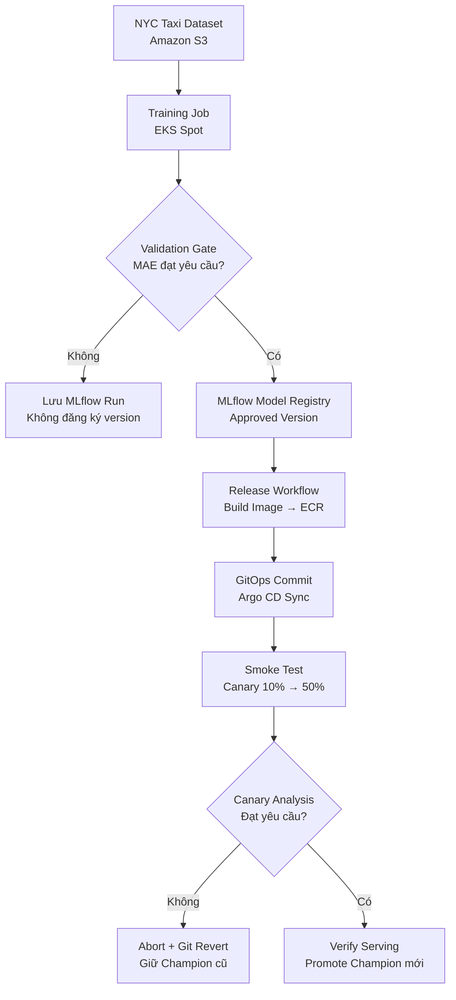
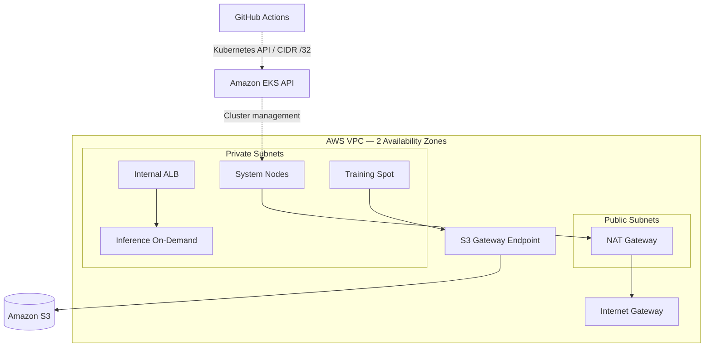

# CHƯƠNG 1. GIỚI THIỆU ĐỀ TÀI VÀ CÔNG NGHỆ SỬ DỤNG

## 1.1. Giới thiệu đề tài

### 1.1.1. Bối cảnh và động lực thực hiện

Trong các ứng dụng học máy, việc xây dựng một mô hình có độ chính xác tốt mới chỉ là một phần của quá trình phát triển. Khi đưa mô hình vào sử dụng thực tế, hệ thống còn phải đáp ứng những yêu cầu về quản lý phiên bản, tự động hóa triển khai, giám sát hiệu năng và xử lý sự cố. Nếu các công đoạn này thiếu sự liên kết, việc cập nhật mô hình có thể gây ra sai lệch phiên bản, suy giảm chất lượng dịch vụ hoặc khó khăn khi cần khôi phục hệ thống.

MLOps (Machine Learning Operations) giải quyết những vấn đề trên bằng cách kết hợp Machine Learning với các phương pháp DevOps, hướng đến việc quản lý và tự động hóa toàn bộ vòng đời mô hình, từ huấn luyện, đánh giá đến triển khai và vận hành.

Xuất phát từ nhu cầu đó, đề tài **xây dựng nền tảng MLOps trên Amazon Web Services (AWS)** được thực hiện nhằm nghiên cứu và triển khai một quy trình học máy hoàn chỉnh trên môi trường cloud, đồng thời kiểm chứng khả năng quản lý phiên bản và phát hành mô hình an toàn.

### 1.1.2. Mục tiêu của đề tài

Mục tiêu chính là xây dựng nền tảng MLOps trên AWS, tích hợp các thành phần huấn luyện, quản lý mô hình, triển khai dịch vụ và giám sát thành một quy trình thống nhất.

Các mục tiêu cụ thể bao gồm:

- **Quản lý hạ tầng:** Sử dụng Infrastructure as Code để triển khai môi trường Kubernetes và phân bổ tài nguyên tính toán phù hợp cho từng workload.

- **Tự động hóa huấn luyện:** Thực hiện training trên cloud, theo dõi thí nghiệm, đánh giá chất lượng và quản lý phiên bản mô hình.

- **Triển khai dịch vụ dự đoán:** Đóng gói mô hình thành API và xây dựng quy trình CI/CD kết hợp GitOps.

- **Giám sát và kiểm soát phát hành:** Theo dõi hiệu năng, triển khai canary và hỗ trợ khôi phục phiên bản ổn định khi bản phát hành không đạt yêu cầu.

### 1.1.3. Phạm vi thực hiện

Đề tài sử dụng bài toán dự đoán thời lượng chuyến đi taxi tại New York làm ứng dụng minh họa. Phạm vi triển khai được chia thành bốn giai đoạn:

1. **AWS Infrastructure:** Xây dựng hạ tầng bằng Terraform, triển khai Amazon EKS và cơ chế quản lý tài nguyên Kubernetes.

2. **Training Pipeline & Model Registry:** Huấn luyện mô hình trên cloud, đánh giá chất lượng và quản lý phiên bản bằng MLflow.

3. **Model Serving & CI/CD:** Xây dựng FastAPI, đóng gói container và tổ chức các workflow kiểm thử, huấn luyện, phát hành.

4. **Progressive Delivery & Observability:** Triển khai canary, giám sát hiệu năng và kiểm chứng cơ chế rollback.

Hệ thống được triển khai trong môi trường phát triển và thực nghiệm. Các chức năng như tự động phát hiện data drift, tái huấn luyện liên tục, High Availability và Disaster Recovery toàn diện chưa thuộc phạm vi hiện thực.

## 1.2. Bài toán ứng dụng: Dự đoán thời lượng chuyến đi taxi

### 1.2.1. Mô tả bài toán

Bài toán **NYC Taxi Trip Duration Prediction** nhằm dự đoán thời lượng của một chuyến taxi dựa trên khu vực đón khách, khu vực trả khách và thời điểm bắt đầu chuyến đi. Đây là bài toán hồi quy (Regression), với đầu ra là thời gian di chuyển dự kiến tính bằng phút.

Mô hình chỉ sử dụng những thông tin có thể biết trước khi chuyến đi diễn ra. Các thuộc tính phát sinh sau khi kết thúc chuyến đi, chẳng hạn thời điểm trả khách hoặc giá cước, không được sử dụng làm đặc trưng đầu vào nhằm tránh hiện tượng rò rỉ dữ liệu (Data Leakage).

Trong đề tài, bài toán đóng vai trò ứng dụng thực tế để kiểm chứng quy trình MLOps, thay vì tập trung phát triển một hệ thống dự đoán giao thông chuyên biệt.

### 1.2.2. Dữ liệu và quá trình chuẩn bị

Đề tài sử dụng bộ dữ liệu **Yellow Taxi Trip Records** do New York City Taxi and Limousine Commission (NYC TLC) công bố. Dữ liệu gồm các bản ghi chuyến đi với thông tin thời gian, khu vực đón/trả khách và những thuộc tính liên quan.

Sau khi loại bỏ các bản ghi không hợp lệ, hệ thống lấy mẫu xác định với seed bằng 42, tối đa 100.000 bản ghi mỗi tháng. Dữ liệu được chia theo thứ tự thời gian:

|Tập dữ liệu|Khoảng thời gian|Số bản ghi|
|---|---|---|
|Training|01–02/2025|200.000|
|Validation|03/2025|100.000|
|Testing|04/2025|100.000|
|**Tổng cộng**|**01–04/2025**|**400.000**|

Cách chia này sử dụng dữ liệu quá khứ để huấn luyện và các giai đoạn tiếp theo để đánh giá, hạn chế việc trộn dữ liệu tương lai vào tập huấn luyện.

Thời lượng chuyến đi được tính từ chênh lệch giữa thời điểm trả khách và đón khách, giới hạn trong khoảng 1–180 phút. Mô hình sử dụng năm đặc trưng:

|Đặc trưng|Ý nghĩa|
|---|---|
|`PULocationID`|Mã khu vực đón khách|
|`DOLocationID`|Mã khu vực trả khách|
|`pickup_hour`|Giờ bắt đầu chuyến đi|
|`pickup_day_of_week`|Thứ trong tuần|
|`pickup_month`|Tháng bắt đầu chuyến đi|

Hai mã khu vực được xử lý như đặc trưng phân loại, trong khi các đặc trưng thời gian được trích xuất từ thời điểm đón khách. Dữ liệu được lưu trữ trên Amazon S3 để phục vụ quá trình huấn luyện trên cloud.

### 1.2.3. Mô hình và phương pháp đánh giá

Đề tài sử dụng **LightGBM (Light Gradient Boosting Machine)**, một thuật toán Gradient Boosted Decision Trees phù hợp với dữ liệu dạng bảng và hỗ trợ đặc trưng phân loại.

Để đánh giá chất lượng, hệ thống sử dụng mô hình baseline dự đoán theo trung vị thời lượng chuyến đi của tập huấn luyện. Kết quả LightGBM được đánh giá bằng hai chỉ số:

- **MAE (Mean Absolute Error):** Sai số tuyệt đối trung bình giữa giá trị dự đoán và thực tế, được sử dụng làm chỉ số đánh giá chính.

- **RMSE (Root Mean Squared Error):** Căn bậc hai của sai số bình phương trung bình, giúp phản ánh rõ hơn các trường hợp có sai số lớn.

Quá trình lựa chọn mô hình dựa trên tập validation, trong khi tập test được sử dụng để đánh giá sau kiểm duyệt. Kết quả validation cũng là cơ sở cho **Validation Gate** quyết định một mô hình ứng viên có đủ điều kiện đăng ký phiên bản mới trong Model Registry hay không.

Quy trình huấn luyện được trình bày tại Chương 3 và kết quả đánh giá được phân tích tại Chương 4.

## 1.3. Công nghệ sử dụng và quyết định thiết kế

Các công nghệ được lựa chọn theo vai trò trong vòng đời MLOps, kết hợp dịch vụ AWS với các công cụ mã nguồn mở nhằm đáp ứng yêu cầu triển khai, tự động hóa và giám sát hệ thống.

### 1.3.1. Nhóm hạ tầng và điều phối tài nguyên

|Công nghệ|Vai trò|
|---|---|
|**AWS**|Cung cấp môi trường cloud và các dịch vụ tính toán, mạng, lưu trữ|
|**Terraform**|Quản lý hạ tầng theo mô hình Infrastructure as Code|
|**Amazon EKS / Kubernetes**|Điều phối container và các workload của hệ thống|
|**Karpenter**|Tự động cấp phát và thu hồi EC2 node theo nhu cầu|
|**Amazon S3 / ECR / EBS**|Lưu trữ datasets, model artifacts, container images và dữ liệu bền vững|

Terraform đảm nhiệm việc quản lý tài nguyên AWS, trong khi Kubernetes tổ chức và vận hành các thành phần ứng dụng.

Hệ thống sử dụng **EC2 Spot cho training workloads** nhằm tối ưu chi phí đối với các tác vụ có thời gian thực thi hữu hạn, đồng thời sử dụng **On-Demand cho model serving** để hạn chế gián đoạn do thu hồi Spot.

### 1.3.2. Nhóm huấn luyện, quản lý mô hình và serving

|Công nghệ|Vai trò|
|---|---|
|**Python / LightGBM**|Tiền xử lý dữ liệu và huấn luyện mô hình|
|**MLflow Tracking**|Theo dõi tham số, metrics và artifacts của các thí nghiệm|
|**MLflow Model Registry**|Quản lý phiên bản, trạng thái phê duyệt và alias `champion`|
|**PostgreSQL**|Lưu trữ metadata của MLflow|
|**FastAPI**|Cung cấp HTTP API cho dịch vụ dự đoán|

MLflow giúp liên kết mỗi phiên bản mô hình với kết quả huấn luyện và thông tin nguồn, hỗ trợ việc truy vết và so sánh các thí nghiệm.

Mô hình được phê duyệt sẽ được đóng gói cùng ứng dụng FastAPI thành container image, bảo đảm phiên bản phục vụ gắn với một bản phát hành xác định.

### 1.3.3. Nhóm CI/CD, triển khai và giám sát

|Công nghệ|Vai trò|
|---|---|
|**GitHub Actions**|Tự động kiểm thử, huấn luyện và phát hành|
|**AWS IAM / OIDC**|Xác thực và phân quyền cho các workflow truy cập AWS|
|**Argo CD**|Đồng bộ ứng dụng trên Kubernetes theo cấu hình GitOps|
|**Argo Rollouts**|Triển khai canary và kiểm soát quá trình phát hành|
|**AWS Application Load Balancer**|Phân phối lưu lượng giữa stable và canary|
|**Prometheus / Grafana**|Thu thập, truy vấn và trực quan hóa metrics|
|**k6**|Tạo tải HTTP và đánh giá hiệu năng dịch vụ|

GitHub Actions đảm nhiệm các quy trình CI/CD, còn Argo CD đồng bộ trạng thái hệ thống theo cấu hình được quản lý trong Git. Argo Rollouts kết hợp ALB và Prometheus để triển khai canary và đánh giá phiên bản mới trước khi chuyển toàn bộ lưu lượng.

Một quyết định thiết kế quan trọng là **tách biệt kiểm duyệt chất lượng mô hình và kiểm duyệt bản phát hành**. Mô hình được Validation Gate phê duyệt chưa đồng nghĩa có thể đưa ngay vào phục vụ; phiên bản mới còn phải đáp ứng các điều kiện vận hành trong quá trình triển khai.

Cách tổ chức này giúp nền tảng kiểm soát cả chất lượng dự đoán và rủi ro phát hành mô hình.

# CHƯƠNG 2. KIẾN TRÚC HỆ THỐNG

## 2.1. Kiến trúc tổng thể

### 2.1.1. Tổ chức các thành phần hệ thống

Nền tảng MLOps được triển khai trên AWS, sử dụng Amazon EKS để điều phối các thành phần ứng dụng. Kiến trúc kết hợp dịch vụ cloud với các công cụ mã nguồn mở, tổ chức thành bốn nhóm chức năng chính:

|Nhóm chức năng|Thành phần chính|Trách nhiệm|
|---|---|---|
|**Infrastructure**|Terraform, AWS VPC, EKS, Karpenter, S3, ECR, EBS|Quản lý hạ tầng, tài nguyên tính toán và lưu trữ|
|**Training & Registry**|LightGBM, Kubernetes Job, MLflow, PostgreSQL|Huấn luyện, đánh giá và quản lý phiên bản mô hình|
|**Delivery & Serving**|GitHub Actions, Argo CD, Argo Rollouts, ALB, FastAPI|Phát hành, triển khai và phục vụ mô hình|
|**Observability**|Metrics Server, HPA, Prometheus, Grafana|Giám sát hiệu năng và điều chỉnh tài nguyên|

Các thành phần liên kết thông qua dữ liệu, model artifacts, container images và cấu hình triển khai. Kết quả huấn luyện được quản lý trong MLflow, trong khi phiên bản phục vụ được đóng gói thành container image và triển khai thông qua GitOps.

![[Pasted image 20261117212434.png]]

**[PLACEHOLDER — Hình 2.1: Kiến trúc tổng thể nền tảng MLOps trên AWS]**

### 2.1.2. Quản lý hạ tầng và vận hành

Hạ tầng AWS được quản lý bằng Terraform và chia thành ba lớp có vòng đời độc lập:

- **Bootstrap:** Khởi tạo tài nguyên phục vụ lưu trữ Terraform state.

- **Persistent:** Quản lý các tài nguyên cần duy trì lâu dài như S3 datasets, model artifacts, backups và ECR.

- **Platform:** Triển khai VPC, EKS, IAM và các thành phần hạ tầng phục vụ vận hành Kubernetes.

Cách tổ chức này cho phép quản lý hoặc dừng môi trường thực nghiệm mà không đồng thời xóa những dữ liệu và artifacts cần được bảo toàn.

Trong EKS, Managed Node Group `system` vận hành các dịch vụ nền như MLflow, PostgreSQL và monitoring. Karpenter quản lý hai NodePool riêng biệt: `training-spot` dành cho Kubernetes Training Jobs và `inference-on-demand` dành cho dịch vụ FastAPI. Việc sử dụng Spot cho workload huấn luyện giúp tối ưu chi phí, trong khi On-Demand được ưu tiên cho dịch vụ dự đoán cần hoạt động ổn định.

Hệ thống sử dụng GitHub Actions để thực hiện các workflow kiểm thử, huấn luyện và phát hành. Các workflow truy cập AWS thông qua OIDC kết hợp IAM Role, với quyền hạn được phân tách theo nhiệm vụ.

Đối với ứng dụng serving, GitOps được sử dụng để quản lý trạng thái triển khai. Argo CD theo dõi cấu hình Kubernetes trong repository và đồng bộ các thay đổi lên EKS. Argo Rollouts điều phối quá trình cập nhật phiên bản, trong khi ALB phân phối yêu cầu giữa hai Kubernetes Service: `inference-api` (stable) và `inference-api-canary` (candidate).

Các thành phần giám sát hoạt động song song với dịch vụ dự đoán. Prometheus thu thập request metrics và latency từ FastAPI; Grafana hỗ trợ trực quan hóa các chỉ số. Metrics Server cung cấp dữ liệu CPU cho Horizontal Pod Autoscaler (HPA), cho phép điều chỉnh số lượng Pod phục vụ theo tải.

Trong kiến trúc này, **HPA điều chỉnh số Pod của Rollout**, còn Karpenter quản lý tài nguyên EC2 node. Hai cơ chế phối hợp nhưng đảm nhiệm những cấp độ mở rộng khác nhau.

## 2.2. Luồng dữ liệu và vòng đời mô hình

Hệ thống tổ chức vòng đời mô hình thành hai quy trình chính: **huấn luyện và kiểm duyệt mô hình**, sau đó **phát hành và giám sát phiên bản phục vụ**. Hai quy trình được tách biệt nhằm bảo đảm mô hình đạt yêu cầu về chất lượng dự đoán trước khi được đánh giá khả năng vận hành.

**[PLACEHOLDER — Hình 2.2: Luồng dữ liệu và vòng đời mô hình MLOps]**

_Hình thể hiện Dataset → Training → Validation Gate → Model Registry → Release → GitOps → Canary → Serving. Bổ sung các nhánh candidate bị từ chối, phát hành thành công và rollback khi canary không đạt yêu cầu._

### 2.2.1. Huấn luyện và quản lý mô hình

Dữ liệu NYC Taxi được kiểm tra và lưu trên Amazon S3. Khi Training workflow được kích hoạt, Kubernetes Job trên Spot node thực hiện tiền xử lý, huấn luyện LightGBM và ghi nhận kết quả vào MLflow. Metadata được lưu trong PostgreSQL, còn model artifacts được lưu trên S3.

Sau huấn luyện, **Validation Gate** so sánh chất lượng candidate với mô hình tham chiếu trên cùng tập validation. Nếu không đạt yêu cầu, kết quả thí nghiệm vẫn được lưu nhưng không tạo phiên bản Registry mới. Ngược lại, candidate đạt yêu cầu sẽ được đăng ký và phê duyệt trong MLflow Model Registry.

Quy trình huấn luyện không tự động triển khai mô hình hoặc thay đổi alias `champion`. Việc cập nhật phiên bản phục vụ được kiểm soát thông qua Release workflow độc lập.

### 2.2.2. Phát hành và kiểm soát phiên bản phục vụ

Release workflow tiếp nhận một phiên bản mô hình đã được phê duyệt, xác minh thông tin và đóng gói model cùng ứng dụng FastAPI thành Docker image. Image được lưu trên Amazon ECR và tham chiếu bằng digest trong GitOps manifests. Argo CD đồng bộ cấu hình mới, sau đó Argo Rollouts điều phối quá trình triển khai.

Trước khi nhận lưu lượng, candidate phải vượt qua bước kiểm tra trạng thái và danh tính bản phát hành. Hệ thống tiếp tục phân chia traffic qua ALB theo các mức **10% → 50%**, đồng thời sử dụng Prometheus để đánh giá tỷ lệ lỗi HTTP 5xx, P95 latency và lưu lượng đến candidate.

Khi các điều kiện được đáp ứng, phiên bản mới được promotion và workflow xác minh trạng thái phục vụ trước khi cập nhật alias `champion`. Nếu candidate bị từ chối, Argo Rollouts thực hiện abort, đưa traffic trở lại stable; workflow tiếp tục hoàn nguyên thay đổi GitOps có kiểm soát và giữ nguyên phiên bản champion trước đó.

Cơ chế này hình thành **hai lớp kiểm soát độc lập**: Validation Gate đánh giá chất lượng mô hình, còn Canary Analysis đánh giá khả năng vận hành khi triển khai. Cơ chế rollback tự động hiện được áp dụng cho trường hợp candidate bị từ chối theo các điều kiện xác định, không bao phủ mọi tình huống lỗi của workflow.

---

Kiến trúc trên là cơ sở để triển khai các thành phần hạ tầng, huấn luyện và phục vụ mô hình. Cách hiện thực cụ thể được trình bày trong Chương 3, trong khi kết quả kiểm chứng và đánh giá hệ thống được tập trung tại Chương 4.

# CHƯƠNG 3. HIỆN THỰC HỆ THỐNG

Chương này trình bày các thành phần chính được hiện thực để xây dựng nền tảng MLOps trên AWS, tập trung vào quản lý hạ tầng, tự động hóa huấn luyện, triển khai dịch vụ và kiểm soát phát hành. Kết quả kiểm chứng và đánh giá hệ thống được trình bày tại Chương 4.

## 3.1. Triển khai hạ tầng AWS và Kubernetes

### 3.1.1. Quản lý hạ tầng bằng Terraform

Hạ tầng được triển khai bằng Terraform, với mã nguồn tổ chức trong thư mục `infra/terraform/`. Các tài nguyên được quản lý thông qua ba lớp Bootstrap, Persistent và Platform như đã trình bày ở Chương 2. Việc phân tách này cho phép quản lý vòng đời hạ tầng độc lập với những dữ liệu và artifacts cần được bảo toàn.

Trong quá trình hiện thực, nhóm sử dụng Terraform để cấu hình VPC trên hai Availability Zones, hệ thống mạng public/private subnets, Amazon EKS và các dịch vụ lưu trữ liên quan. Các tài nguyên lưu trữ quan trọng được áp dụng cơ chế mã hóa, versioning và hạn chế xóa ngoài ý muốn. Quá trình triển khai được thực hiện thông qua `terraform plan` và `terraform apply` để kiểm tra thay đổi trước khi áp dụng lên AWS.

**[Hình 3.1 – Cấu trúc mạng AWS và EKS]**

_Hình 3.1. Cấu trúc mạng và các thành phần hạ tầng triển khai trên AWS._

### 3.1.2. Điều phối tài nguyên và quản lý quyền truy cập

Amazon EKS được sử dụng để vận hành các thành phần của nền tảng dưới dạng Kubernetes workloads. Nhóm triển khai Managed Node Group `system` cho các dịch vụ nền và sử dụng Karpenter để quản lý hai NodePool chuyên biệt:

- `**training-spot**`**:** Cấp phát Spot Instances cho các Kubernetes Jobs huấn luyện mô hình.

- `**inference-on-demand**`**:** Sử dụng On-Demand Instances cho dịch vụ FastAPI nhằm hạn chế rủi ro gián đoạn trong quá trình phục vụ.

Các workload được phân bổ thông qua node selectors, taints và tolerations. Karpenter hỗ trợ cấp phát tài nguyên khi có nhu cầu và thu hồi các node không còn workload, góp phần hạn chế chi phí vận hành.

Về bảo mật, hệ thống kết hợp AWS IAM, EKS Pod Identity và Kubernetes RBAC để phân quyền truy cập. Các GitHub Actions workflows sử dụng OIDC với IAM Role riêng cho Training và Release, cho phép truy cập AWS bằng credentials tạm thời thay vì lưu trữ access key trực tiếp trong mã nguồn.

## 3.2. Pipeline huấn luyện và quản lý mô hình

### 3.2.1. Xây dựng và thực thi Training Pipeline

Pipeline huấn luyện được hiện thực trong `src/training/`, sử dụng LightGBM cho bài toán dự đoán thời lượng chuyến đi taxi. Dữ liệu NYC TLC được xử lý và chia thành các tập training, validation và testing như đã trình bày ở Chương 1, sau đó lưu trữ trên Amazon S3. Logic tạo đặc trưng được tái sử dụng giữa training và inference nhằm bảo đảm tính nhất quán khi triển khai mô hình.

Quy trình huấn luyện trên cloud được thực thi thông qua GitHub Actions workflow `train.yml`. Workflow xây dựng container image, đẩy lên Amazon ECR và khởi tạo Kubernetes Training Job trên Spot NodePool của EKS. Job thực hiện huấn luyện, đánh giá mô hình và ghi nhận kết quả vào MLflow, sau đó các tài nguyên tạm được dọn dẹp.

Chất lượng mô hình được đánh giá bằng hai chỉ số **MAE (Mean Absolute Error)** và **RMSE (Root Mean Squared Error)**, trong đó MAE được sử dụng làm tiêu chí chính để lựa chọn mô hình. Kết quả đánh giá trên tập validation là cơ sở cho bước kiểm duyệt trước khi đăng ký phiên bản mới.

### 3.2.2. Validation Gate và MLflow Model Registry

Sau huấn luyện, hệ thống sử dụng Validation Gate để kiểm tra chất lượng của mô hình ứng viên so với mô hình tham chiếu. Điều kiện chấp nhận được xác định như sau:

[  
MAE_{\text{candidate}} \leq MAE_{\text{reference}} \times (1-\delta)  
]

Trong đó, (\delta = 0{,}01) tương ứng với yêu cầu cải thiện tối thiểu **1% Validation MAE**. Khi đã có mô hình `champion`, hệ thống sử dụng phiên bản này làm tham chiếu; trường hợp chưa có phiên bản phù hợp sẽ sử dụng baseline đã xác định.

Nếu candidate không đạt yêu cầu, kết quả thí nghiệm vẫn được lưu trong MLflow Tracking nhưng không tạo phiên bản Model Registry mới. Ngược lại, mô hình đạt điều kiện sẽ được đăng ký và phê duyệt để phục vụ quy trình phát hành.

MLflow sử dụng PostgreSQL để quản lý metadata và Amazon S3 để lưu trữ model artifacts, kèm thông tin định danh nhằm hỗ trợ truy vết phiên bản. Hệ thống cũng hiện thực cơ chế backup/restore cho PostgreSQL để bảo toàn dữ liệu Registry. Alias `champion` chỉ được cập nhật sau khi phiên bản mới hoàn tất kiểm chứng triển khai, không thay đổi ngay tại bước huấn luyện.

## 3.3. Triển khai dịch vụ suy luận và quy trình CI/CD

### 3.3.1. Xây dựng dịch vụ suy luận với FastAPI

Dịch vụ suy luận được xây dựng bằng FastAPI, sử dụng mô hình LightGBM đã được phê duyệt trong MLflow Model Registry. Mô hình và các thành phần cần thiết được đóng gói cùng ứng dụng thành Docker image, cho phép xử lý yêu cầu mà không cần truy cập trực tiếp MLflow hoặc S3 trong mỗi lần dự đoán.

Các API chính được triển khai bao gồm:

|API|Chức năng|
|---|---|
|`POST /predict`|Tiếp nhận dữ liệu và trả về kết quả dự đoán.|
|`GET /healthz`|Kiểm tra trạng thái hoạt động của ứng dụng.|
|`GET /readyz`|Xác nhận dịch vụ sẵn sàng phục vụ.|
|`GET /model-info`|Truy xuất thông tin và phiên bản mô hình.|
|`GET /metrics`|Cung cấp metrics cho Prometheus.|

Dữ liệu đầu vào được kiểm tra bằng Pydantic và chuyển đổi theo cùng đặc tả đặc trưng đã sử dụng khi huấn luyện. Dịch vụ được triển khai trên EKS với tài nguyên On-Demand để phục vụ các yêu cầu suy luận.

### 3.3.2. Tự động hóa CI/CD và triển khai theo GitOps

Nhóm sử dụng GitHub Actions để tổ chức quy trình tự động hóa thông qua ba workflows:

|Workflow|Chức năng|
|---|---|
|`ci.yml`|Kiểm thử mã nguồn và cấu hình hệ thống.|
|`train.yml`|Huấn luyện mô hình trên EKS và thực hiện Validation Gate.|
|`release.yml`|Đóng gói, triển khai và xác minh phiên bản mô hình được phê duyệt.|

Khi có thay đổi phù hợp trên nhánh `main`, hệ thống thực hiện CI và xác định nhu cầu huấn luyện dựa trên thay đổi của mã nguồn. Training workflow chỉ chuyển tiếp sang Release khi mô hình vượt qua Validation Gate, đồng thời sử dụng checkpoint để hạn chế xử lý trùng lặp.

Trong quá trình phát hành, mô hình được đóng gói thành Docker image và lưu trữ trên Amazon ECR với định danh digest bất biến. Release workflow cập nhật image digest trong GitOps manifests, sau đó Argo CD đồng bộ cấu hình mới lên Kubernetes.

Phiên bản mới tiếp tục được kiểm chứng thông qua Canary Deployment trước khi chính thức thay thế phiên bản đang phục vụ. Cách tổ chức này bảo đảm việc kiểm duyệt mô hình và quyết định phát hành được thực hiện độc lập.

## 3.4. Triển khai Canary, giám sát và tự động mở rộng

### 3.4.1. Canary Deployment và cơ chế khôi phục

Hệ thống sử dụng Argo Rollouts kết hợp AWS Application Load Balancer để thực hiện triển khai Canary. Phiên bản ứng viên được kiểm tra bằng Smoke Test trước khi tiếp nhận lưu lượng theo các mức **10% và 50%**, với thời gian quan sát hai phút tại mỗi giai đoạn.

Trong quá trình triển khai, Argo Rollouts sử dụng Prometheus để đánh giá các tiêu chí được cấu hình trong `AnalysisTemplate`:

|Tiêu chí|Điều kiện chấp nhận|
|---|---|
|Tỷ lệ HTTP 5xx của Canary|Nhỏ hơn 1%.|
|Độ trễ P95 của Canary|Nhỏ hơn 500 ms.|
|P95 so với Stable|Nhỏ hơn `1,5 × P95 Stable + 50 ms`.|
|Tốc độ yêu cầu đến Canary|Tối thiểu 0,2 request/giây.|

Để cung cấp lưu lượng đánh giá trong môi trường thực nghiệm, Release workflow sử dụng Kubernetes Job chạy k6 với mức tải cấu hình 40 RPS.

Khi các điều kiện được đáp ứng, phiên bản mới được Promotion và cập nhật alias `champion` sau khi xác minh trạng thái phục vụ. Nếu Canary bị từ chối, Argo Rollouts thực hiện Abort để khôi phục lưu lượng về Stable; Release workflow tiếp tục hoàn tác thay đổi GitOps bằng cơ chế guarded Git revert.

Cơ chế khôi phục được áp dụng cho các trường hợp Canary bị từ chối theo điều kiện kiểm duyệt đã xác định, không mặc định bao phủ mọi tình huống lỗi trong quá trình phát hành.

### 3.4.2. Giám sát vận hành và tự động mở rộng

Hệ thống sử dụng Prometheus để thu thập các chỉ số vận hành từ FastAPI, bao gồm request rate, HTTP error rate và latency. Grafana được sử dụng để trực quan hóa metrics, phục vụ việc theo dõi tình trạng hệ thống và đánh giá các thử nghiệm.

Khả năng tự động mở rộng được hiện thực thông qua Horizontal Pod Autoscaler (HPA), với đối tượng điều chỉnh là `inference-api` Rollout. HPA được cấu hình từ **1 đến 3 replica**, sử dụng ngưỡng CPU utilization mục tiêu **60%** và thời gian ổn định khi giảm replica là **300 giây**.

HPA điều chỉnh số lượng Pod theo mức sử dụng CPU, trong khi Karpenter đảm nhiệm việc cấp phát tài nguyên node khi cần thiết. Các cơ chế này được tích hợp vào hệ thống serving để hỗ trợ điều chỉnh năng lực phục vụ theo tải.

# CHƯƠNG 4. THỰC NGHIỆM VÀ ĐÁNH GIÁ KẾT QUẢ

Chương này trình bày kết quả kiểm chứng nền tảng MLOps được triển khai trên AWS, tập trung vào khả năng vận hành hạ tầng, huấn luyện và quản lý mô hình, cung cấp dịch vụ suy luận, giám sát hiệu năng và kiểm soát quá trình phát hành. Các thí nghiệm được thực hiện trên hệ thống thực tế và đối chiếu thông qua giao diện quản lý, kết quả API, GitHub Actions và dữ liệu giám sát.

## 4.1. Kiểm chứng hạ tầng triển khai trên AWS

Hệ thống đã được triển khai thành công trên Amazon EKS tại khu vực `ap-southeast-1`, sử dụng Kubernetes phiên bản 1.36. Cluster `mlops-aws-dev` hoạt động ở trạng thái **Active**, với ba worker nodes thuộc hai nhóm tài nguyên: hai node phục vụ các thành phần hệ thống và một node dành cho dịch vụ suy luận.

Các node sử dụng EC2 `t3.large` On-Demand, trong khi tài nguyên huấn luyện được cấp phát động thông qua Karpenter trên Spot Instances. Quá trình kiểm thử ghi nhận Training Jobs thực thi thành công trên các Spot nodes và các tài nguyên tạm được thu hồi sau khi hoàn tất.

**[H01 – AWS Infrastructure]**

_Hình 4.1. Hạ tầng tính toán và các workloads đang hoạt động trên Amazon EKS._

Tại namespace `mlops`, các thành phần chính gồm PostgreSQL, MLflow và FastAPI inference đều hoạt động ở trạng thái Running. Kết quả này xác nhận các dịch vụ của nền tảng đã được triển khai và vận hành trên hạ tầng AWS thay vì chỉ được kiểm chứng trong môi trường phát triển cục bộ.

## 4.2. Đánh giá quá trình huấn luyện và quản lý mô hình

### 4.2.1. Kiểm chứng Model Validation Gate

Nhóm thực hiện hai trường hợp huấn luyện nhằm kiểm chứng khả năng chấp nhận hoặc từ chối mô hình mới. Các thí nghiệm sử dụng cùng tập dữ liệu đánh giá và duy trì ngưỡng yêu cầu cải thiện tối thiểu **1% Validation MAE** so với mô hình champion hiện tại.

**[H02 – Model Validation Gate: Approved và Rejected]**

_Hình 4.2. Kết quả kiểm duyệt mô hình trong hai trường hợp Approved và Rejected._

**Bảng 4.1. So sánh kết quả Validation Gate**

|Tiêu chí|Approved|Rejected|
|---|---|---|
|Candidate MAE (phút)|3,6445|7,8622|
|Reference MAE (phút)|3,6949|3,6445|
|Reference model|v2|v3|
|Validation Gate|Approved|Rejected|
|Model version mới|v3|Không tạo|
|Release|Thực hiện|Bỏ qua|

Trong trường hợp **Approved**, mô hình ứng viên đạt MAE 3,6445 phút, cải thiện khoảng **1,36%** so với champion v2. Kết quả vượt ngưỡng kiểm duyệt, được đăng ký thành phiên bản v3 và chuyển tiếp sang quy trình phát hành.

Ngược lại, mô hình ở trường hợp **Rejected** có MAE 7,8622 phút, không đáp ứng yêu cầu cải thiện so với champion v3. Hệ thống ghi nhận kết quả huấn luyện nhưng không tạo Registry version mới và tự động bỏ qua Release.

Đáng chú ý, Training workflow trong cả hai trường hợp đều hoàn tất thành công về mặt thực thi. Điều này cho thấy hệ thống phân biệt được **trạng thái thực thi huấn luyện** với **quyết định chất lượng mô hình**, tránh phát hành một mô hình chỉ vì quá trình huấn luyện không gặp lỗi kỹ thuật.

### 4.2.2. Kiểm chứng MLflow Model Registry

**[H03 – MLflow Registry]**

_Hình 4.3. Các phiên bản mô hình được quản lý trong MLflow Model Registry._

MLflow ghi nhận ba phiên bản mô hình đã được phê duyệt, với Validation MAE lần lượt là 3,8372 phút (v1), 3,6949 phút (v2) và 3,6445 phút (v3). Alias `champion` hiện trỏ đến v3 sau khi phiên bản này hoàn tất quá trình phát hành và xác minh dịch vụ.

Đối với mô hình bị từ chối, thông tin huấn luyện vẫn được lưu trong MLflow Tracking để phục vụ truy vết, nhưng không xuất hiện thêm phiên bản trong Registry. Kết quả cho thấy hệ thống duy trì được lịch sử thí nghiệm mà không làm ảnh hưởng đến phiên bản đang phục vụ.

## 4.3. Kiểm chứng dịch vụ suy luận và giám sát vận hành

### 4.3.1. Kiểm chứng FastAPI Model Serving

Dịch vụ FastAPI được kiểm tra thông qua các endpoint `/model-info` và `/predict` trên môi trường EKS.

**[H04 – FastAPI Serving]**

_Hình 4.4. Kết quả truy xuất thông tin mô hình và thực hiện dự đoán qua FastAPI._

API `/model-info` trả về HTTP 200 cùng thông tin mô hình đang phục vụ, bao gồm phiên bản v3, MLflow Run ID, Release ID và các metadata kiểm chứng tương ứng.

Đối với `/predict`, hệ thống xử lý thành công yêu cầu dự đoán thời lượng chuyến đi và trả về kết quả **15,7537 phút**, kèm tên và phiên bản mô hình v3.

Kết quả xác nhận ứng dụng suy luận đã nạp đúng phiên bản được phát hành và có khả năng xử lý yêu cầu thực tế. Thông tin định danh được đối chiếu với MLflow Registry và gói mô hình đã triển khai nhằm bảo đảm tính nhất quán giữa huấn luyện và phục vụ.

### 4.3.2. Kiểm chứng GitOps Deployment

**[H05 – Argo CD GitOps]**

_Hình 4.5. Trạng thái đồng bộ và các tài nguyên Kubernetes được quản lý bởi Argo CD._

Giao diện Argo CD ghi nhận Application `inference-api` ở trạng thái **Synced** và **Healthy**. Các tài nguyên liên quan, gồm Rollout, ReplicaSets, Services, HPA và AnalysisRuns, được quản lý trong cùng Application.

Đối chiếu trạng thái GitOps với hệ thống đang chạy cho thấy phiên bản phục vụ được đồng bộ theo cấu hình lưu trong Git. Sau các thử nghiệm phát hành và khôi phục, Argo CD tiếp tục duy trì trạng thái Healthy với mô hình champion v3.

Kết quả này xác nhận khả năng quản lý trạng thái triển khai và khôi phục cấu hình của cơ chế GitOps đã hiện thực.

### 4.3.3. Đánh giá giám sát và tự động mở rộng

Nhóm sử dụng k6 để tạo lưu lượng HTTP qua Internal ALB nhằm đánh giá khả năng phục vụ và phản ứng của HPA khi tải thay đổi. Các chỉ số request rate được thu thập từ Prometheus, trong khi mức sử dụng CPU và số lượng replica được ghi nhận từ Kubernetes HPA. Dữ liệu lịch sử sau đó được tái hiện trên Grafana thông qua TestData CSV Content để quan sát đồng thời các chỉ số.

**[H06 – Monitoring & HPA]**

_Hình 4.6. Diễn biến thông lượng yêu cầu, mức sử dụng CPU và số lượng replica trong thử nghiệm HPA._

**Bảng 4.2. Kết quả các kịch bản kiểm thử tải**

|Chỉ số|Hiệu chỉnh tải|Tải phát hành thông thường|
|---|---|---|
|Tải yêu cầu (RPS)|100|40|
|Tốc độ xử lý thực tế (RPS)|83,17|39,85|
|Tổng số yêu cầu hoàn thành|14.974|23.913|
|P95 phía client (ms)|603,84|31,63|
|HTTP failures|4|0|
|Dropped iterations|3.026|88|

Hai kịch bản được thực hiện độc lập: thử nghiệm hiệu chỉnh tải sử dụng phiên bản Stable v1 để quan sát HPA, trong khi tải phát hành thông thường được ghi nhận trong quá trình phát hành v1 lên v2.

Ở mức tải 40 RPS, hệ thống đạt tốc độ xử lý thực tế gần với mức yêu cầu, với P95 khoảng 31,63 ms và không ghi nhận HTTP failure trong bài kiểm thử này.

Khi tăng tải lên 100 RPS, tốc độ xử lý thực tế đạt 83,17 RPS, độ trễ P95 tăng đáng kể và xuất hiện các iterations không thể khởi tạo đúng lịch. Thử nghiệm đồng thời ghi nhận bốn phản hồi ELB 502. Kết quả cho thấy hệ thống chưa duy trì được thông lượng mục tiêu 100 RPS trong cấu hình kiểm thử này.

Biểu đồ Grafana cho thấy mức sử dụng CPU tăng vượt ngưỡng mục tiêu 60%, có thời điểm đạt **310% CPU request**. HPA tương ứng điều chỉnh số lượng replica từ **1 lên 3**, sau đó giảm về **1** khi tải kết thúc và hết thời gian ổn định. Diễn biến này xác nhận HPA đã phản ứng với sự thay đổi tải và điều chỉnh số lượng Pod theo cấu hình.

Những kết quả trên xác nhận cơ chế giám sát và tự động mở rộng hoạt động theo thiết kế. Tuy nhiên, thí nghiệm chưa có đối chứng cùng mức tải với số replica cố định, nên chưa kết luận mức cải thiện throughput do riêng HPA mang lại.

## 4.4. Kiểm chứng Canary Deployment và tự động hóa toàn trình

### 4.4.1. Kiểm chứng Canary thất bại và tự động khôi phục

Để đánh giá khả năng xử lý phiên bản không đạt yêu cầu, nhóm thực hiện một Release có kiểm soát trên mô hình v3. Phiên bản Stable giữ nguyên cấu hình, trong khi Canary candidate sử dụng cùng mô hình nhưng bị giới hạn CPU xuống `100m` nhằm tạo ra sự suy giảm hiệu năng khi nhận lưu lượng.

Smoke Test ban đầu thành công, xác nhận candidate có thể khởi động và thực hiện suy luận. Tuy nhiên, khi nhận lưu lượng thực, AnalysisRun ghi nhận hai mẫu P95 lần lượt là **964,31 ms** và **884,37 ms**, vượt ngưỡng cho phép 500 ms.

Các tiêu chí về tốc độ yêu cầu và tỷ lệ lỗi HTTP 5xx tại ứng dụng vẫn đạt yêu cầu. Vì vậy, quyết định từ chối Canary xuất phát từ vi phạm điều kiện độ trễ, không phải lỗi khởi động hoặc thiếu lưu lượng đánh giá.

**[H07 – Failed Canary & Rollback]**

_Hình 4.7. Biến động thông lượng, độ trễ P95 và phân phối lưu lượng ALB khi Canary bị từ chối._

Biểu đồ Grafana cho thấy Canary vẫn tiếp nhận yêu cầu tại bước phân phối 10%, nhưng độ trễ P95 tăng vượt ngưỡng kiểm duyệt. Khi AnalysisRun chuyển sang trạng thái Failed, Argo Rollouts thực hiện **Abort**, đưa lưu lượng trở lại Stable. Release workflow sau đó tự động tạo Git revert commit để hoàn tác cấu hình triển khai ứng viên.

Kết quả xác minh sau khôi phục cho thấy:

- Argo CD trở về trạng thái Synced/Healthy.

- Stable sử dụng lại image và cấu hình CPU ban đầu.

- MLflow champion và phiên bản đang phục vụ vẫn là v3.

Thử nghiệm xác nhận hệ thống có khả năng từ chối một Canary vi phạm điều kiện hiệu năng và khôi phục trạng thái triển khai đã được xác minh. Trường hợp này sử dụng Release workflow được kích hoạt thủ công với cơ chế fault injection, không phải một lần chạy đầy đủ toàn bộ pipeline tự động.

### 4.4.2. Kiểm chứng Canary thành công

Trong trường hợp phát hành thành công, hệ thống thực hiện chuyển đổi từ mô hình v2 sang v3 thông qua các giai đoạn phân phối lưu lượng tăng dần. Candidate được đánh giá bằng Prometheus trong quá trình triển khai trước khi hoàn tất Promotion và trở thành phiên bản Stable mới.

**[H08 – Successful Canary & ALB]**

_Hình 4.8. Thông lượng, độ trễ P95 và quá trình chuyển đổi lưu lượng khi Canary v3 được phát hành thành công._

Kết quả quan sát trực tiếp từ ALB xác nhận các trạng thái phân bổ lưu lượng:

|Giai đoạn|Stable|Canary|
|---|---|---|
|Ban đầu|100%|0%|
|Canary bước 1|90%|10%|
|Canary bước 2|50%|50%|
|Sau Promotion|100%|0%|

Biểu đồ Grafana thể hiện sự thay đổi request rate giữa hai ReplicaSet tương ứng với quá trình chuyển đổi lưu lượng. Các số liệu Prometheus cho thấy tỷ lệ lưu lượng đến Canary ước lượng khoảng **9,59%** và **49,83%** tại hai bước kiểm thử, phù hợp với trọng số định tuyến được cấu hình.

Trong các mẫu đánh giá hợp lệ của AnalysisRun, Canary đạt toàn bộ điều kiện kiểm duyệt. P95 phía server dao động khoảng 24,56–46,67 ms, thấp hơn ngưỡng 500 ms; tỷ lệ lỗi HTTP 5xx của ứng dụng bằng 0. Những mẫu chưa đủ dữ liệu ban đầu được đánh giá lại khi lưu lượng trở nên phù hợp.

Sau khi Canary thành công, hệ thống xác minh trạng thái phục vụ trước khi cập nhật `champion` từ v2 sang v3. Trọng số 100/0 ở bước cuối tương ứng với Stable đã chuyển sang mô hình mới, không phải khôi phục phiên bản cũ.

### 4.4.3. Kiểm chứng quy trình MLOps tự động toàn trình

**[H09 – Automatic E2E Pipeline]**

_Hình 4.9. Kết quả thực thi tự động toàn bộ quy trình CI, Training và Release trên GitHub Actions._

Thử nghiệm end-to-end được kích hoạt từ thay đổi mã nguồn huấn luyện trên nhánh `main`. GitHub Actions thực hiện thành công bốn nhóm kiểm thử Infrastructure, Training, Serving và GitOps, trước khi tự động khởi chạy Training trên EKS Spot.

Khi mô hình v3 vượt Validation Gate, hệ thống tiếp tục thực hiện Release, triển khai Canary và xác minh dịch vụ mà không yêu cầu kích hoạt Training hoặc Release thủ công. Workflow ghi nhận **9/9 jobs thành công**, với checkpoint cuối ở trạng thái `completed`.

Kết quả đối chiếu sau khi hoàn tất cho thấy mô hình được phê duyệt, phiên bản đang phục vụ và alias `champion` đều thống nhất tại v3. Hệ thống đồng thời thu hồi các Training Jobs, traffic Jobs và Spot resources tạm, trong khi các dịch vụ chính tiếp tục hoạt động.

Kết quả này chứng minh chuỗi tự động hóa **CI → Training → Validation → Release → Canary → Promotion** đã được thực thi thành công trên môi trường AWS thực tế.

### 4.4.4. Đánh giá tổng hợp

Các thí nghiệm cho thấy nền tảng đã đáp ứng những mục tiêu chính của đề tài, từ triển khai hạ tầng, huấn luyện và quản lý mô hình đến tự động hóa phát hành và giám sát vận hành trên AWS.

Hệ thống đã kiểm chứng thành công hai lớp kiểm soát chất lượng. **Validation Gate** chỉ chấp thuận những mô hình đạt yêu cầu, trong khi **Canary Analysis** đánh giá khả năng vận hành trước khi phát hành. Các thử nghiệm xác nhận cả hai trường hợp: phiên bản đạt yêu cầu được Promotion thành công và phiên bản vi phạm điều kiện hiệu năng bị từ chối, sau đó tự động khôi phục trạng thái Stable.

Bên cạnh đó, quy trình MLOps tự động toàn trình đã được thực thi thành công, kết hợp với khả năng giám sát và điều chỉnh số lượng replica thông qua HPA. Tuy nhiên, các cơ chế mở rộng và khôi phục mới được kiểm chứng trong phạm vi thử nghiệm có kiểm soát, chưa đủ để khẳng định khả năng vận hành ổn định trong mọi tình huống.

Nhìn chung, hệ thống đã chứng minh được tính khả thi của việc tích hợp các công nghệ MLOps thành một nền tảng thống nhất, đồng thời tạo cơ sở cho những cải tiến về độ tin cậy và khả năng vận hành thực tế.

# CHƯƠNG 5. KẾT LUẬN VÀ HƯỚNG PHÁT TRIỂN

## 5.1. Kết quả đạt được và hạn chế

Đề tài đã xây dựng và kiểm chứng thành công nền tảng MLOps trên AWS, tích hợp các chức năng chính của vòng đời Machine Learning, từ huấn luyện và quản lý mô hình đến triển khai, giám sát và kiểm soát phát hành.

Những kết quả đạt được bao gồm:

- **Hạ tầng và quản lý tài nguyên:** Sử dụng Terraform để triển khai hạ tầng AWS, kết hợp Amazon EKS và Karpenter để điều phối tài nguyên. Workload huấn luyện được triển khai trên Spot Instances, trong khi dịch vụ suy luận sử dụng On-Demand Instances.

- **Huấn luyện và quản lý mô hình:** Xây dựng Training Pipeline với LightGBM, tích hợp MLflow để theo dõi thí nghiệm và quản lý phiên bản. Validation Gate hỗ trợ kiểm duyệt chất lượng mô hình trước khi chuyển sang giai đoạn phát hành.

- **Tự động hóa triển khai:** Tích hợp GitHub Actions, FastAPI, Argo CD và Argo Rollouts để thực hiện CI/CD và Canary Deployment. Hệ thống đã kiểm chứng thành công quy trình tự động toàn trình, bao gồm cả khả năng từ chối bản phát hành không đạt yêu cầu và khôi phục phiên bản Stable.

- **Giám sát và mở rộng:** Sử dụng Prometheus và Grafana để theo dõi các chỉ số vận hành. HPA cho phép tự động điều chỉnh số lượng replica theo mức sử dụng CPU.

Bên cạnh những kết quả trên, hệ thống vẫn còn một số hạn chế. Kiến trúc hiện tại chưa đáp ứng đầy đủ yêu cầu **High Availability** và **Disaster Recovery**. Mặc dù đã có cơ chế backup/restore, khả năng khôi phục khi xảy ra sự cố lớn vẫn cần được đánh giá thêm.

Đối với quá trình vận hành, cơ chế Canary và rollback mới được kiểm chứng trong các kịch bản xác định, chưa bao phủ mọi tình huống lỗi. HPA đã thể hiện khả năng tự động mở rộng nhưng chưa có thử nghiệm đối chứng để đánh giá hiệu quả cải thiện thông lượng. Ngoài ra, dữ liệu giám sát chưa được lưu trữ dài hạn và hệ thống chưa hỗ trợ phát hiện Data Drift để tự động kích hoạt tái huấn luyện.

## 5.2. Hướng phát triển

Từ các kết quả và hạn chế trên, đề tài có thể tiếp tục được phát triển theo những hướng chính:

- **Nâng cao tính sẵn sàng và khả năng phục hồi:** Hoàn thiện kiến trúc High Availability, triển khai các thành phần quan trọng trên nhiều Availability Zones và xây dựng chiến lược Disaster Recovery với các chỉ tiêu RPO, RTO cụ thể.

- **Cải thiện giám sát và độ tin cậy khi phát hành:** Bổ sung lưu trữ metrics dài hạn, cảnh báo tự động và kiểm thử thêm các tình huống lỗi Canary. Đồng thời, thực hiện thử nghiệm tải có đối chứng để đánh giá hiệu quả mở rộng của HPA và Karpenter.

- **Hoàn thiện vòng đời MLOps tự động:** Triển khai Data Drift Detection để phát hiện sự thay đổi của dữ liệu, từ đó kích hoạt tái huấn luyện và đánh giá mô hình. Các phiên bản mới tiếp tục được kiểm soát thông qua Validation Gate và Canary Deployment trước khi phát hành.

- **Tăng cường bảo mật:** Hoàn thiện quản lý secrets, phân quyền truy cập và kiểm tra an toàn cho container images cùng các quy trình CI/CD.

Nhìn chung, đề tài đã hoàn thành mục tiêu xây dựng và kiểm chứng một nền tảng MLOps trên AWS trong phạm vi thực nghiệm, tạo cơ sở để tiếp tục phát triển thành hệ thống có độ tin cậy và khả năng tự động hóa cao hơn.

