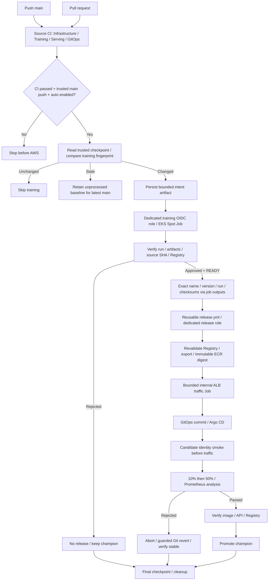

# CI → Training → Release tự động

Source triển khai pipeline tự động bằng ba workflows hiện có. **Automatic mode mặc định tắt** khi repository variable chưa đặt hoặc khác chuỗi `true`. Cơ chế mới được kiểm tra local/simulated; chưa chạy GitHub Actions/OIDC/EKS end-to-end với source này. Evidence E2E16/11/2026 thuộc pipeline manual trước đó, không thay thế verification của orchestration mới.

## Luồng và trách nhiệm



- `ci.yml` vẫn chạy trên mọi push/PR. `Final CI status` chỉ phụ thuộc bốn module. Job `auto_mlops` cần CI success, event push/main, đúng immutable repository/owner IDs và `AUTO_MLOPS_ENABLED=true`.
- Job này gọi `train.yml` bằng `workflow_call` tại cùng commit; không dispatch workflow khác, không tải executable từ artifact PR. Training manual bằng `workflow_dispatch` vẫn chỉ train, không tự release.
- Training approved mới gọi `release.yml` reusable. Release manual vẫn nhận explicit name/version. Auto mode luôn dùng `canary_test_cpu=off`; fault injection chỉ là tùy chọn dispatch bảo trì hiện có.
- Reusable jobs nằm trong run của workflow caller: trong auto mode training/release chia sẻ **CI run ID/attempt**, không tạo hai workflow run ID dispatch riêng. `github.sha`/`github.ref` là context caller. Xem [GitHub reusable workflow reference](https://docs.github.com/en/actions/reference/workflows-and-actions/reusing-workflow-configurations).

## Training change detection và checkpoint

`auto_mlops.py` tính SHA256 từ Git tree records gồm path/mode/blob của:

- `src/training/**`, `configs/training*.yaml`, `configs/mlflow.yaml`.
- `pyproject.toml`, `uv.lock`, `.dockerignore`, training Dockerfile, Training Job template và service accounts.
- `train_workflow.sh`, `training_result.py`, `workflow_guard.py`, `auto_mlops.py`, `m23-render.py`, `m23-common.sh`, `ci.yml`, `train.yml`.

Shared dependency manifests và training configs được xử lý bảo thủ: thay đổi bất kỳ nội dung trong các file này sẽ yêu cầu training lại. Auto dùng `configs/training.yaml`; chọn config khác phải sửa input trong `ci.yml` bằng source commit đã CI. Dispatch manual vẫn chọn `configs/*.yaml`. Không dùng repository variable thay âm thầm config huấn luyện.

README/docs/images/evidence, `src/inference/**`, release workflow và GitOps Deployment/Rollout digest/metadata không nằm trong fingerprint. Vì vậy GitOps release/revert commit không mở vòng train mới. Push bằng `GITHUB_TOKEN` cũng không tự gây recursive push workflow; fingerprint là lớp bảo vệ độc lập nếu commit được tạo bởi token khác.

So sánh với checkpoint thay vì chỉ `push.before..after` giúp không mất thay đổi khi nhiều commits bị gộp vào một run pending, hoặc doc commit đến sau training change chưa xử lý. `AUTO_MLOPS_BASELINE_SHA` là baseline ban đầu đã được người vận hành review; phải là ancestor main có inputs đã đánh giá, **không đặt HEAD tùy tiện để bỏ qua training chưa thực hiện**.

Artifacts `auto-mlops-intent-<run>-<attempt>` được upload **trước OIDC/cloud**; `auto-mlops-checkpoint-...` được upload sau outcomes:

| Disposition | Ý nghĩa và lần chạy kế tiếp |
|---|---|
| `completed` | Model gate rejected, hoặc approved và release thành công. Watermark chuyển tới source SHA này; inputs không đổi thì skip. |
| `stale` | Main đã thay đổi; chưa hoàn tất pipeline cho source cũ. Giữ baseline chưa xử lý để commit mới nhất đánh giá phần training còn thiếu. |
| `blocked` | Training/release/cleanup chưa hoàn tất an toàn, hoặc chỉ còn intent do run bị ngắt. Cùng fingerprint không tự retry; phải xem trạng thái trước maintenance recovery. |

Plan đọc GitHub API bằng `actions:read`; không AWS. Chỉ chấp nhận artifacts từ Source CI main push của đúng repository, đúng SHA/run/attempt; kiểm digest archive, size≤256KiB, đúng một JSON file, schema và fingerprint tính lại từ Git. Không extract ZIP hoặc execute nội dung. Final checkpoint được ưu tiên hơn intent của cùng attempt; rerun có thể đọc checkpoint immutable của attempt trước để tránh duplicate training.

API/JSON/digest không hợp lệ, checkpoint expired, inventory quá giới hạn hoặc phát hiện cloud attempt thiếu checkpoint đều fail-closed. Lookup bị giới hạn1.000artifacts/1.000CIruns và20attempts/run. Retention90ngày là cửa sổ vận hành, không phải durable database vô hạn. Sau bảo trì/retention, có thể cập nhật baseline SHA **sau khi đối chiếu Registry/runtime và kết quả đã xử lý**; các cursor cũ là ancestor của baseline được bỏ qua. Không tự xóa lịch sử hay tự advance baseline khi bị lỗi.

## SHA, duplicate runs và concurrency

Hai khóa khác nhau:

1. `auto-mlops-<cluster>` ở caller job giữ toàn chuỗi plan→train→release→checkpoint. Không cancel run đang chạy. GitHub mặc định chỉ giữ một pending run; run pending mới có thể thay run cũ, nên không dựa vào FIFO.
2. `eks-<cluster>-mutation` chỉ ở job Training/Release thực sự dùng AWS; manual và automatic dùng cùng khóa. Training đã cleanup CIDRs và nhả khóa trước khi Release lấy khóa. Reusable caller không giữ khóa mutation, tránh deadlock.

Checkout exact source SHA, yêu cầu bằng `GITHUB_SHA` và current remote main trước credentials/CIDR; kiểm lại trong training trước build/Job và sau verification, trong release trước build/push GitOps. Main thay đổi làm dừng nguồn cũ; fast-forward Git push và verifier main/revision guards vẫn bảo vệ các cửa sổ race. Không force push hoặc rebase tự động. Một training đang chạy có thể đã đăng ký candidate trước khi phát hiện stale; candidate đó không được release tự động, logs phải được giữ để review. Đây không phải exactly-once transaction với MLflow/AWS.

## Approved khác với workflow success

`training_result.py verify` kiểm tra run FINISHED, gate status, persisted metrics/schema/manifest/model checksums, dataset key, Registry READY/approved/run ID. Automatic path còn so manifest Git SHA và source tree checksum với exact Git commit/image build inventory. Host không dự đoán Registry version.

Step `outputs` chỉ xuất handoff khi schema đầy đủ. Rejected có version/Registry status null: workflow có thể success nhưng release condition false. Approved phải có READY và numeric version rõ ràng. Release nhận JSON qua job outputs→typed reusable inputs, validate trước OIDC, rồi **đọc lại live Registry/artifacts** trước export và so exported model/manifest hashes với decision. Không dùng `latest` hoặc chỉ `needs.train.result == success` để release.

Training và Release có IAM roles riêng. STS account guard chạy trước CIDR mutation; OIDC trust không đổi. Namespace traffic không có Pod Identity/IRSA, không có secrets được đưa vào Pod.

## Traffic tự động trong môi trường dev

Trước GitOps commit, sau khi image build/validation xong, release đọc đúng Ingress `mlops/inference-api`, yêu cầu schemeinternal và một hostname `internal-*.REGION.elb.amazonaws.com`. Không nhận URL tùy ý hoặc mở endpoint public.

Job `m32-traffic-<run>-<attempt>` trong namespace **`mlops-release-traffic`** dùng k6 cùng version1.8.2 đã có trong project:

- Valid prediction inputs; constant arrival40RPS,20VUs,600s, graceful stop10s; deadline660s, không retry, TTL300s.
- Requests100mCPU/128Mi, limits500mCPU/512Mi; chạy system nodes, non-root, read-only root, không service-account token. Namespace quota1Job/1Pod giới hạn workload bị bỏ quên.
- Tối đa nominal24.000iterations/trial; HPA/NodePool hiện hữu vẫn có thể scale khi tải, nên phải tính chi phí EKS/EC2/network. Giới hạn không là cam kết40RPS thực tế luôn đạt.
- Setup phải truy cập `/healthz` qua ALB thành công và log readiness marker trước GitOps push. Verifier yêu cầu Job còn active trong canary wait và trước champion promotion.
- k6 không dùng HTTP error threshold để gán application failure thành generator failure. Request errors vẫn vào serving/ALB metrics; Prometheus gates hiện hữu quyết định candidate. Generator có budget dropped<1.200 (abort sớm sau grace60s nếu vượt) và completed≥22.800 khi chạy đủ duration; đây là kiểm tra nguồn tải, không đổi application thresholds.
- Job failed/expired/mất API thì host fail/timeout đúng loại, không tự coi là candidate rejected/rollback. Thiếu request/NaN vẫn dùng AnalysisTemplate hiện hữu và không được host promote champion. Argo Rollouts là controller độc lập: host failure không phải transaction đảo mọi thay đổi runtime nếu controller đã promote trước đó; phải đối chiếu trạng thái.
- Release thường kết thúc trước600s, nên logs có thể chỉ là cửa sổ partial, không có full-duration summary; không suy ra đạt40RPS từ Job active. EXIT trap và step `always()` cùng cleanup exact run-owned Job, thu logs; CIDR restore vẫn chạy tiếp kể cả cleanup failure. Runner chết hoàn toàn cần TTL/deadline và runbook kiểm tra CIDRs. Không hứa cleanup chắc chắn khi runner/API mất hoàn toàn.

Không cần người vận hành tạo k6 Job mỗi release sau khi bootstrap quyền một lần. Đã kiểm tra script bằng Docker `k6 inspect --network none`; **chưa chạy cloud load bằng source mới**. Giới hạn503/selector churn trong Post-E2E Review chưa được sửa bằng cơ chế này.

## Bật/tắt và điều kiện trước khi bật

Source bàn giao không bật repository variable. Các lệnh sau là **bước triển khai tương lai có cloud mutation**, chưa chạy trong lần phát triển này:

1. Review/commit/push source theo quy trình Git của repository; để `AUTO_MLOPS_ENABLED=false` hoặc unset. Source CI phải xanh với source mới.
2. Xác nhận cluster/Registry/Argo/Prometheus/ALB đang hoạt động; IAM training/release và customized OIDC main subject đúng. GitHub token phải có quyền commit/revert bình thường theo branch policy; không bypass protection.
3. Sau khi được phép, apply RBAC cập nhật và namespace traffic:

   ```bash
   kubectl apply -f deploy/bootstrap/m32-github-release-rbac.yaml
   kubectl apply -f deploy/bootstrap/release-traffic-rbac.yaml
   ```

   Không cần Terraform apply/IAM trust mới. Kiểm bằng dedicated release identity: get đúng Ingress; create/get/delete Jobs và read pod/logs trong namespace traffic; không có quyền secrets hoặc Jobs trong namespace app.
4. Đặt repository Variables hiện có trong [setup](setup.md#9-github-actions-citrainingrelease), thêm `AUTO_MLOPS_BASELINE_SHA=<reviewed-main-commit>` và `AUTO_MLOPS_ENABLED=true` (chữ thường). Chọn baseline có bằng chứng input đã xử lý; không chỉ copy SHA nhằm skip các thay đổi mới.
5. Thực hiện một thay đổi training có kiểm soát qua PR/merge. CI passed sẽ tự train; rejected sẽ dừng hợp lệ, approved mới release exact version và tự tạo traffic. Không cần dispatch/approval từng lần sau khi đã bật.

Tắt bằng `AUTO_MLOPS_ENABLED=false`. CI và dispatch manual vẫn hoạt động. Biến thay đổi không thu hồi job đang chạy; nếu cần dừng khẩn, xem Job/CIDR/GitOps/Registry và thực hiện cleanup có kiểm soát. Không cancel tùy tiện rồi giả định CIDRs đã restore.

## Outcomes và xử lý sự cố

| Quan sát | Xử lý |
|---|---|
| CI failed / PR / fork / flag off | Không có automatic AWS job. Sửa source hoặc cấu hình; không cần cloud cleanup chỉ vì CI failed. |
| `no-training-change` | Skip hợp lệ, kể cả docs/image/GitOps-only; kiểm baseline/fingerprint khi nghi ngờ. |
| `stale` | Run cũ không release. Latest main CI đánh giá cumulative changes; không force push/reuse sai SHA. |
| `rejected` | Gate hợp lệ, không tạo approved version, không release/champion change. Không hạ threshold để làm xanh. |
| `blocked` / mất checkpoint | Đọc logs/artifacts, Registry versions, runtime và CIDRs. Maintenance manual nếu cần; chỉ acknowledge baseline sau reconciliation. |
| Canary rejectedexit3 | Runtime abort + guarded Git revert + stable verification theo cơ chế cũ; main di chuyển hoặc push bị từ chối vẫn cần xử lý thủ công. |
| Missing metrics / generator failure / timeout / network / verification failure | Fail-closed ở host; không khẳng định đã auto rollback. Không promote bằng tay để che lỗi. |
| Workflow fail sau verification/cleanup | Có thể champion đã được promote hợp lệ trước lỗi cleanup; đọc result/runtime, không suy ra champion vẫn cũ chỉ từ run Failure. |

Chưa nghiệm thu source mới trên GitHub/AWS. Kế hoạch verification cần phê duyệt riêng: CI thật khi auto off; kiểm dedicated RBAC; một rejected training rồi một approved candidate/release có budget; theo dõi đủ traffic, Argo/ALB/Registry; kiểm cleanup/CIDR cuối. Không suy ra cloud pass từ tests synthetic hoặc evidence16/11.
